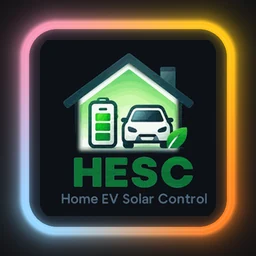
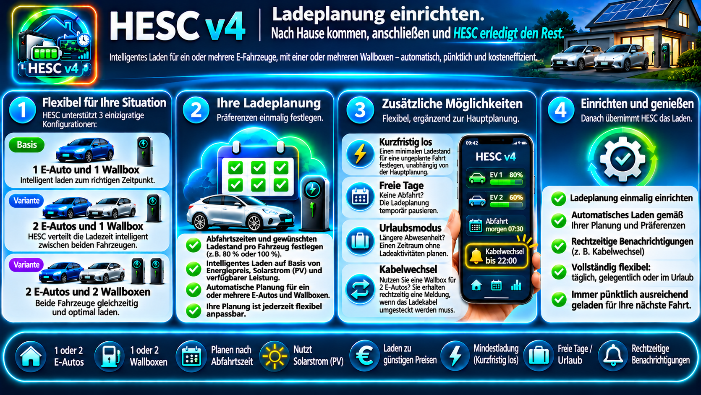
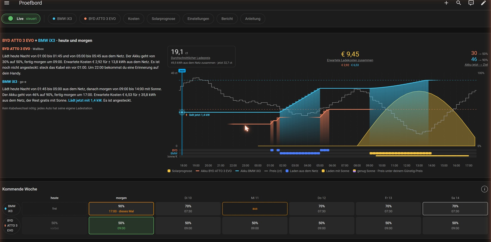
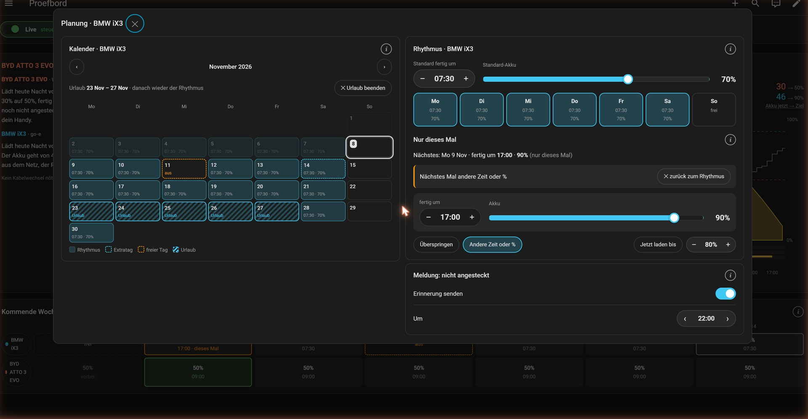
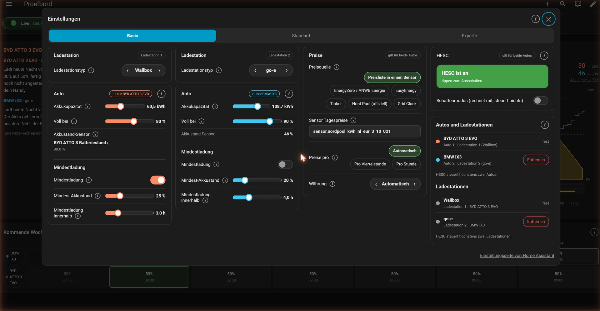
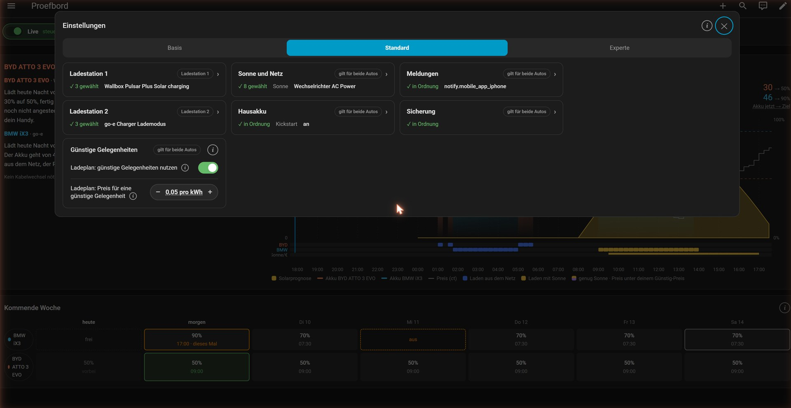
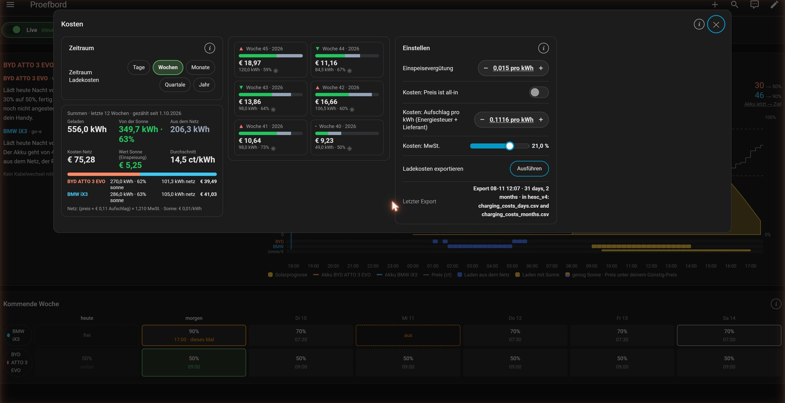
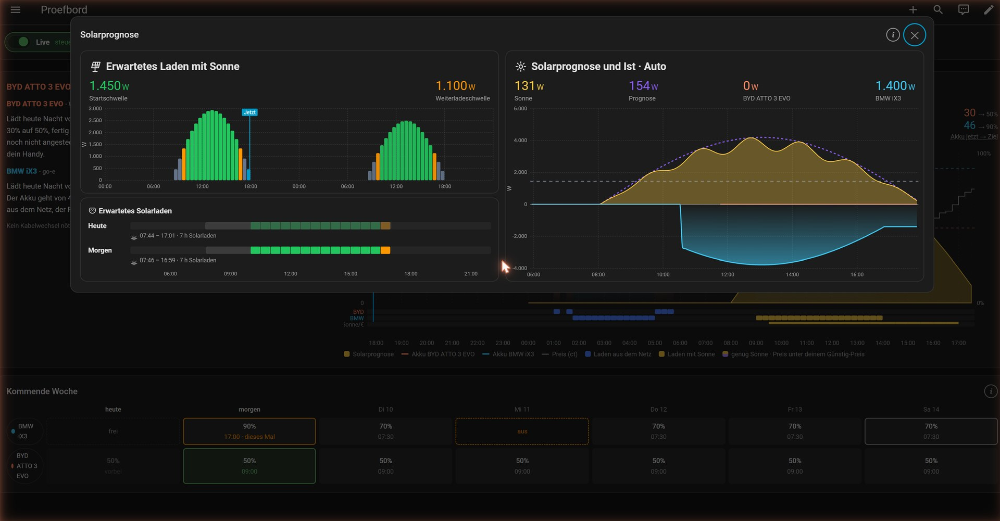

   

# HESC v4 — Smart EV Charging Management

*Ladeplanung einrichten. Nach Hause kommen, anschließen und HESC erledigt den Rest.*

*English: [README.md](README.md) · Nederlands: [README.nl.md](README.nl.md)*

HESC lädt dein Elektroauto so viel wie möglich mit deinem eigenen Solarstrom und, wenn die Sonne
nicht reicht, aus dem Netz zu den günstigsten Zeiten. HESC v4 ist der Nachfolger von HESC v3: einfacher
einzurichten, mit einem eigenen Panel in Home Assistant und mit **zwei Autos und zwei Wallboxen**.

> **Release Candidate (RC1).** HESC v4 ist der Nachfolger der HESC-v3-Reihe. Der Wechsel von v3 und zurück ist jederzeit möglich, siehe [Installieren](#1-installieren).

Das Panel folgt der Sprache deines Home-Assistant-Profils: Niederländisch, Deutsch, und Englisch für alle anderen Sprachen.

## Inhalt

1. [Installieren](#1-installieren)
2. [Der erste Start](#2-der-erste-start)
3. [Was HESC selbst findet und was du selbst einträgst](#3-was-hesc-selbst-findet-und-was-du-selbst-einträgst)
4. [Ein oder zwei Autos, eine oder zwei Wallboxen](#4-ein-oder-zwei-autos-eine-oder-zwei-wallboxen)
5. [Das Panel](#5-das-panel)
6. [Planung](#6-planung)
7. [Einstellungen](#7-einstellungen)
8. [HESC an, aus und Schatten](#8-hesc-an-aus-und-schatten)
9. [Kosten, Solarprognose und Bericht](#9-kosten-solarprognose-und-bericht)
10. [Was noch nicht fertig ist](#was-noch-nicht-fertig-ist)

## 1. Installieren

1. Suche **HESC** in HACS und installiere die neueste Version. Starte Home Assistant neu.
2. *Einstellungen → Geräte & Dienste → Integration hinzufügen → HESC v4*.
3. Eine Frage: **HESC v4 installieren?** Ist HESC v3 installiert, kannst du auch die Einstellungen von v3 übernehmen.
4. In der Seitenleiste erscheint **HESC v4**. Dort beginnt der erste Start.

**Von v3 zu v4, und zurück.** HESC v4 kommt neben v3; nichts wird gelöscht. Übernimmst du die
Einstellungen von v3, pausiert v4 danach v3, damit immer nur einer die Wallbox steuert. Zurück:
*Einstellungen › Experte › Meldungen › Zurück zu v3* schaltet v3 wieder ein und pausiert v4. Ist v3
nicht mehr in HACS, wähle dort zuerst eine v3-Version.

Nach der Installation ist HESC im **Schattenmodus**: es rechnet und zeigt, was es tun würde, schaltet
aber nichts. Erst nach dem ersten Start kannst du den Schattenmodus ausschalten.

## 2. Der erste Start

Der erste Start fragt zuerst ein paar Dinge und danach nur noch, was HESC nicht selbst gefunden hat.

1. **Wie lädst du zu Hause?** Ein Auto · zwei Autos an einer Wallbox · zwei Autos mit je einer eigenen Wallbox.
2. **Dein Haus.** Anschluss (1 oder 3 Phasen, Ampere), Lastmanagement, Solaranlage, dynamische Preise, und
   die Bestätigung, dass deine Installation das Laden verkraftet.
3. **Wallbox.** Wähle die Marke. Hast du zwei Wallboxen derselben Marke, wählst du, welche welche ist.
4. **Auto.** Name, Farbe und Akkukapazität (letztere nur, wenn das Auto sie nicht selbst meldet).
5. **Was HESC nicht gefunden hat.** Zum Beispiel den Ladestand-Sensor oder die Preise.

Mit einer Wallbox und einem Auto sind das etwa 9 Klicks.

## 3. Was HESC selbst findet und was du selbst einträgst

| Teil | Plug-and-play | Selbst eintragen |
|---|---|---|
| Wallbox | Wallbox, Peblar, Alfen, go-e, Wattpilot, SMA, evcc, Ohme | Zappi und Easee fragen etwas mehr; *Andere* komplett selbst |
| Solarstrom, Smart Meter | meist gefunden; HESC macht einen **Vorschlag** | wenn der Vorschlag nicht stimmt |
| Solarprognose | Solcast und andere Prognosen werden gefunden | — |
| Preise | zuerst dein Land, dann die Quellen dieses Landes: Grid Clock, EnergyZero/ANWB, EasyEnergy, Tibber, Zonneplan, Nord Pool, EPEX Spot, ENTSO-e, PVPC, OMIE, Energi Data Service, Octopus Energy, Amber Electric | *Eigener Sensor mit Preisliste*: wähle den Sensor |
| Akkukapazität | wenn das Auto sie meldet | sonst tippst du sie ein |
| Hausakku | HESC findet deine Speicher und macht einen Vorschlag | Schritt für Schritt bestätigen (pro Speicher oder ein Summensensor) |
| Wetterstation | — | selbst einschalten und den Sensor wählen |

Bei jeder Einstellung steht ein kleines **(i)** mit ein oder zwei Sätzen Erklärung.

## 4. Ein oder zwei Autos, eine oder zwei Wallboxen

- **Ein Auto, eine Wallbox.** Der übliche Fall.
- **Zwei Autos, eine Wallbox.** HESC plant beide Autos: das erste vor der Uhrzeit, zu der du das Kabel
  umsteckst, das andere danach. Die Übersicht sagt, wann du wechselst; eine Erinnerung auf dem Handy ist möglich
  (*Einstellungen › Standard › Kabel umstecken*).
- **Zwei Autos, zwei Wallboxen.** Jedes Auto hat seine eigene Wallbox; gleiche Marke oder verschieden.

Hinzufügen und Entfernen geht unter *Einstellungen › Basis › Autos und Ladestationen*:
- **+ Auto hinzufügen** — ein zweites Auto, an derselben Wallbox oder mit einer eigenen.
- **+ Wallbox hinzufügen** — wenn zwei Autos eine Wallbox teilen, bekommt Auto 2 eine eigene Wallbox.
- **Entfernen** — nur Auto 2 und Wallbox 2. HESC zeigt zuerst, was wegfällt, und fragt nach einer
  Bestätigung. Ladekosten und Verlauf werden nicht gelöscht, sondern behalten.

## 5. Das Panel

Oben eine Reihe Knöpfe: **Live** (Schattenmodus), die Planung pro Auto, **Kosten**,
**Solarprognose**, **Einstellungen**, **Bericht** und **Anleitung**.

**Heute und morgen** — links ein kurzer Brief pro Auto (wann es lädt, mit Sonne oder Netz, bis wie viel
% und was es kostet), rechts die Grafik mit Solarprognose, Preis und den Ladezeiten pro Auto.
**Kommende Woche** — pro Auto die nächsten sieben Tage; tippe ein Auto oder einen Tag an, um die Planung zu öffnen.

## 6. Planung

- **Rhythmus** — eine Standard-Fertigzeit und Akku-%, pro Wochentag an oder aus, oder mit eigener Zeit oder %.
- **Nur dieses Mal** — das nächste Mal überspringen, eine andere Zeit oder %, oder **jetzt laden**.
- **Kalender** — einzelne freie oder zusätzliche Tage, und Urlaub (vom ersten bis zum letzten Tag ziehen).
- **Eigener Tag** — tippe doppelt auf einen Tag (auch einen leeren) für eine eigene Zeit und ein eigenes Ladeziel.
- **Erinnerung: nicht angeschlossen** — eine Erinnerung, wenn das Auto abends nicht an der Wallbox hängt; nicht,
  wenn das Auto in der letzten Stunde einen ausreichenden Akkustand gemeldet hat.
- **Auf dem Telefon** — Monat und Rhythmus haben eigene Seiten; HESC kann auf dem Monat öffnen.

**Jetzt laden ist geschützt.** Die Pfeile wählen nur das Ziel. Erst nach **Start** und der Bestätigung
lädt HESC aus dem Netz. Stoppen geht immer.

## 7. Einstellungen

Drei Reiter:

- **Basis** — Wallbox, Auto(s), Preise, HESC an/aus und *Autos und Ladestationen*. Bei zwei Autos stehen
  sie nebeneinander. Das Etikett **⏻** bei einem Auto schaltet HESC für dieses Auto an oder aus.
- **Standard** — Kacheln: Ladestation 1 (und 2), Sonne und Netz, Hausakku, Meldungen, Sicherung und
  Günstige Gelegenheiten. Eine Kachel zeigt, ob alles in Ordnung ist (✓) oder was fehlt (⚠); tippe darauf für die Details.
  Sonne und Netz, Hausakku, Günstige Gelegenheiten und Meldungen haben **Schritt für Schritt einstellen**: eine
  Frage pro Bildschirm, der Vorschlag von HESC schon angehakt, Live-Werte und eine Übersicht vor dem Speichern.
- **Experte** — Kacheln für die Feinabstimmung: Ladestation, Sonne: starten und weiterladen (mit der
  Wetterstation), Zeiten und Freigabe, HPVC, Empfehlung und Meldungen. Was du oft änderst, steht direkt auf der Kachel.
  Unter *Meldungen* stehen auch **Ersten Start erneut durchlaufen** und **Zurück zu v3**.

**Preise.** Wähle zuerst dein Land; das stellt auch die Währung ein. Danach siehst du nur die Preisquellen
dieses Landes, die bei dir installiert sind, mit einem Tipp zu wählen. Was noch fehlt, nennt HESC darunter.

**Phasen.** Bei 3 Phasen mit einem Zähler pro Phase zeigt *Sonne und Netz*, wie deine Sonne über die Phasen
verteilt ist, jetzt und im Schnitt (zum Beispiel 40% · 38% · 22%). *Experte › Empfehlung › Phasen-Übersicht*
zeigt pro Phase, ob sie genug Sonne für deine Wallbox bekommt, und was du tun kannst.

**Sensoren wählen.** Tippe auf ein Sensorfeld: du bekommst eine kurze Liste, oben die aktuelle Wahl und
der **Vorschlag** von HESC. Nach OK speichert HESC sofort. Die Modi deiner Wallbox für *Laden mit Sonne* und *kein Auto* hakst du an.

## 8. HESC an, aus und Schatten

| Schalter | Was er tut |
|---|---|
| **HESC ist an** (Basis) | Hauptschalter. Aus = HESC tut nichts. |
| **Schattenmodus** (Basis und *Live*) | HESC rechnet und zeigt, was es tun würde, steuert aber nichts. |
| **⏻ pro Auto** (Basis, beim Auto) | Aus = HESC plant noch für dieses Auto, steuert aber dieses Auto und seine eigene Wallbox nicht. Ein anderes Auto macht einfach weiter. |

## 9. Kosten, Solarprognose und Bericht

- **Kosten** — was das Laden gekostet hat, pro Tag, Woche, Monat und Jahr, aus Sonne und aus dem Netz; bei zwei
  Autos pro Auto. *Ladekosten exportieren* schreibt die Kosten in zwei CSV-Dateien im Ordner hesc_v4; mit *Ladekosten herunterladen* holst du sie dir.
- **Solarprognose** — erwartete gegen tatsächliche Sonne, und wann das Auto mit Solarstrom laden kann.
- **Bericht** — der **Ladebericht** (wie das Laden mit Sonne lief, pro Tag, mit Empfehlung), und **sichern oder
  teilen**: vollständige Sicherung, anonym zum Teilen, oder kurz für eine Fehlermeldung. Die vollständige
  Sicherung liegt in einem eigenen Ordner (`/config/hesc_backup`), damit sie bleibt, wenn du HESC entfernst.

## Was noch nicht fertig ist

- Namen deiner eigenen Geräte und Sensoren kommen aus Home Assistant, in der Sprache, die du dort nutzt.
- Die neuen Preisquellen (EPEX Spot, PVPC, OMIE, Energi Data Service, Octopus Energy, Amber Electric, Zonneplan,
  ENTSO-e) sind mit ihrer Listenform getestet, noch nicht auf einer echten Installation. Funktioniert deine Quelle nicht, melde es bitte.

Bildschirmfotos (von Beta.1): Testboard mit Demodaten (erfundene Autos, Preise und Ladeverlauf). Auch auf
[Englisch](docs/images/v4/en/) und [Niederländisch](docs/images/v4/nl/).

## Unterstütze dieses Projekt

Findest du HESC nützlich? Gib ihm einen ⭐ auf GitHub, damit andere es auch finden.

Möchtest du etwas mehr tun? Unterstütze mich auf [Ko-fi](https://ko-fi.com/satscan).

## Lizenz

[GPL-3.0](LICENSE)
