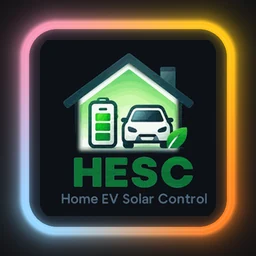
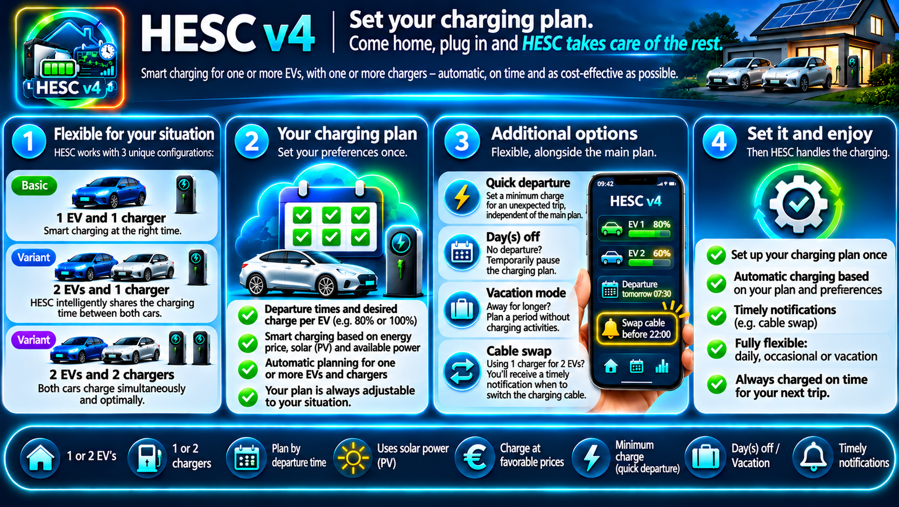
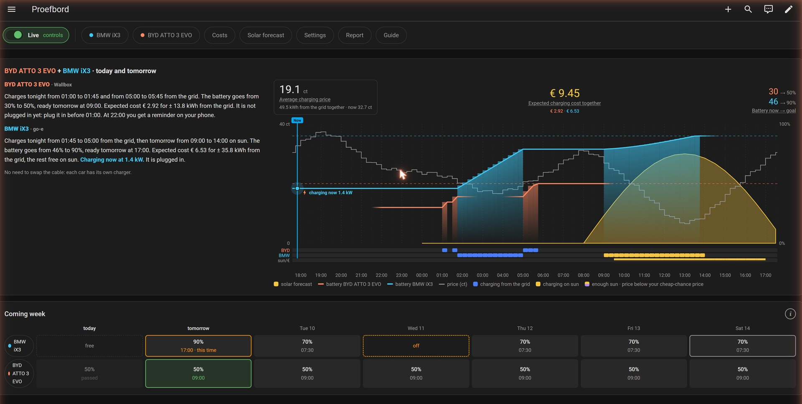
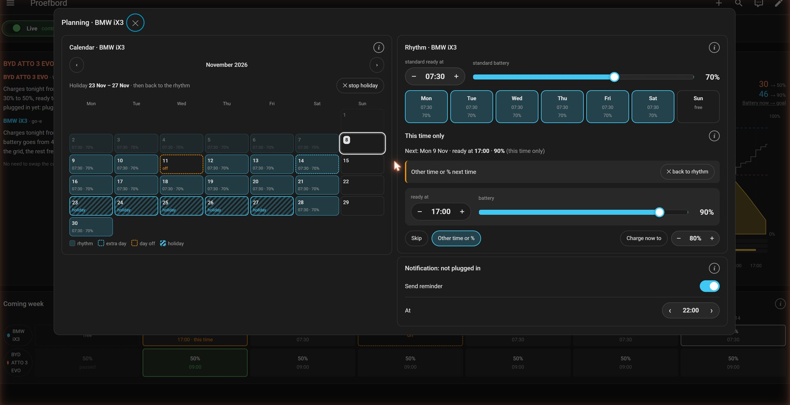
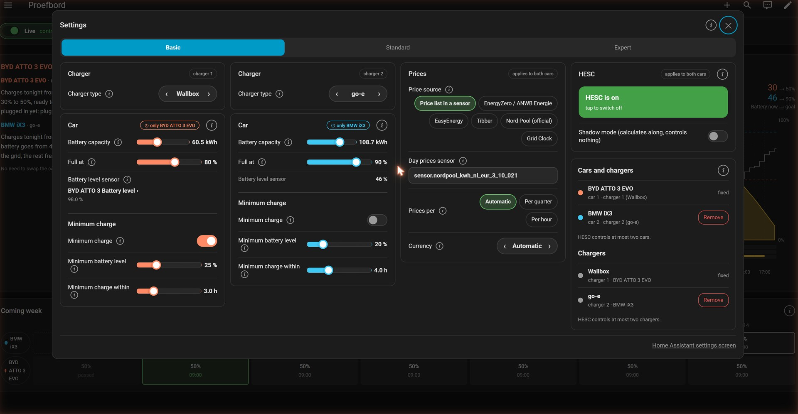
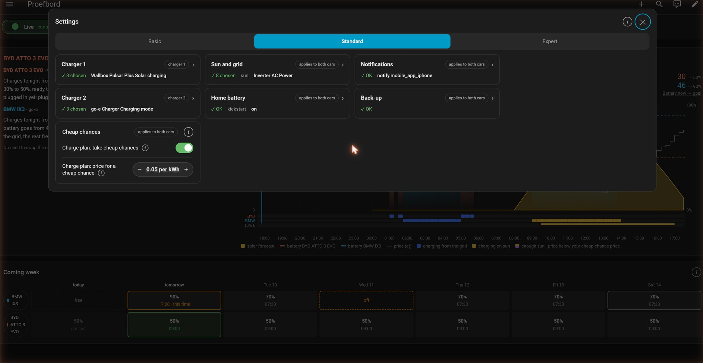
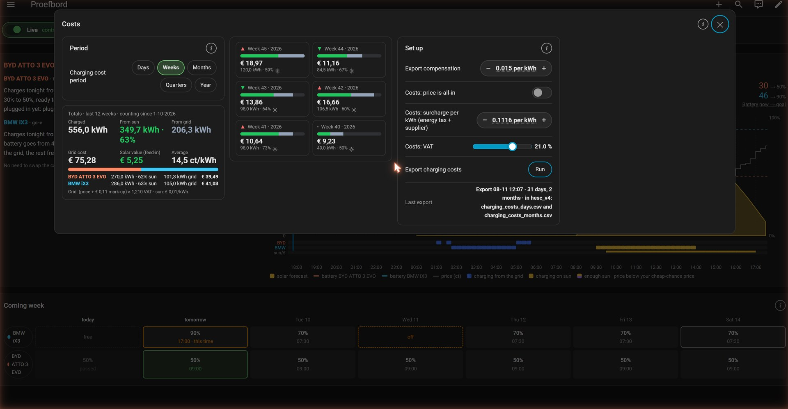
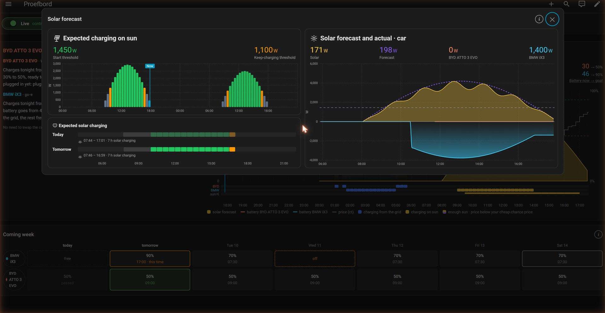

   

# HESC v4 — Smart EV Charging Management

*Set your plan. Plug in. HESC takes care of the rest.*

*Nederlands: [README.nl.md](README.nl.md) · Deutsch: [README.de.md](README.de.md)*

HESC charges your electric car with your own solar power as much as it can, and from the grid at
the cheapest moments when the sun is not enough. HESC v4 is the successor of HESC v3: easier to set
up, with its own panel in Home Assistant and with **two cars and two chargers**.

> **Release candidate (RC1).** HESC v4 is the successor of the HESC v3 series. Switching from v3 and back is always possible, see [Install](#1-install).

The panel follows the language of your Home Assistant profile: Dutch, German, and English for every other language.

## Contents

1. [Install](#1-install)
2. [The first start](#2-the-first-start)
3. [What HESC finds and what you fill in](#3-what-hesc-finds-and-what-you-fill-in)
4. [One or two cars, one or two chargers](#4-one-or-two-cars-one-or-two-chargers)
5. [The panel](#5-the-panel)
6. [Planning](#6-planning)
7. [Settings](#7-settings)
8. [HESC on, off and shadow](#8-hesc-on-off-and-shadow)
9. [Costs, solar forecast and report](#9-costs-solar-forecast-and-report)
10. [Not ready yet](#not-ready-yet)

## 1. Install

1. Search for **HESC** in HACS and install the newest version. Restart Home Assistant.
2. *Settings → Devices & services → Add integration → HESC v4*.
3. One question: **Install HESC v4?** With HESC v3 installed you can also take over v3's settings.
4. **HESC v4** appears in the sidebar. The first start begins there.

**From v3 to v4, and back.** HESC v4 is installed next to v3; nothing is removed. When you take over
v3's settings, v4 then pauses v3, so only one of them ever controls the charger. To go back:
*Settings › Expert › Notifications › Back to v3* turns v3 on again and pauses v4. If v3 is no longer in
HACS, pick a v3 version there first.

After installing, HESC is in **shadow mode**: it calculates and shows what it would do, but switches
nothing. Shadow mode can only be switched off once the first start is done.

## 2. The first start

The first start asks a few things first, and after that only what HESC did not find itself.

1. **How do you charge at home?** One car · two cars on one charger · two cars, each with its own charger.
2. **Your house.** Connection (1 or 3 phases, amps), load balancer, solar panels, dynamic prices, and
   the confirmation that your installation can take the charging.
3. **Charger.** Pick the brand. With two chargers of the same brand you choose which is which.
4. **Car.** Name, colour and battery capacity (the latter only when the car does not report it).
5. **What HESC did not find.** For example the battery-level sensor or the prices.

With a Wallbox and one car this is about 9 taps.

## 3. What HESC finds and what you fill in

| Part | Plug and play | You fill in |
|---|---|---|
| Charger | Wallbox, Peblar, Alfen, go-e, Wattpilot, SMA, evcc, Ohme | Zappi and Easee ask a little more; *Other* all by hand |
| Solar power, smart meter | usually found; HESC makes a **suggestion** | when the suggestion is wrong |
| Solar forecast | Solcast and other forecasts are found | — |
| Prices | your country first, then that country's sources: Grid Clock, EnergyZero/ANWB, EasyEnergy, Tibber, Zonneplan, Nord Pool, EPEX Spot, ENTSO-e, PVPC, OMIE, Energi Data Service, Octopus Energy, Amber Electric | *Own sensor with a price list*: pick the sensor |
| Battery capacity | when the car reports it | otherwise you type it |
| Home battery | HESC finds your batteries and makes a suggestion | confirm step by step (per battery, or one total sensor) |
| Weather station | — | switch it on yourself and pick the sensor |

Every setting has a small **(i)** with one or two sentences of explanation.

## 4. One or two cars, one or two chargers

- **One car, one charger.** The usual case.
- **Two cars, one charger.** HESC plans both cars: the first before the time you move the cable,
  the other after. The overview says when to swap; a reminder on your phone is possible
  (*Settings › Standard › Move the cable*).
- **Two cars, two chargers.** Each car has its own charger; same brand or different.

Adding and removing is done in *Settings › Basic › Cars and chargers*:
- **+ Add car** — a second car, on the same charger or with its own.
- **+ Add charger** — when two cars share one charger, car 2 gets its own charger.
- **Remove** — only car 2 and charger 2. HESC first shows what will go and asks for
  confirmation. Charging costs and history are not deleted but kept.

## 5. The panel

At the top a row of buttons: **Live** (shadow mode), the planning per car, **Costs**,
**Solar forecast**, **Settings**, **Report** and **Guide**.

**Today and tomorrow** — on the left a short letter per car (when it charges, from sun or grid, to what
% and what it costs), on the right the chart with solar forecast, price and the charging moments per car.
**Coming week** — per car the next seven days; tap a car or a day to open its planning.

## 6. Planning

- **Rhythm** — a standard ready time and battery %, per weekday on or off, or with its own time or %.
- **This time only** — skip the next time, another time or %, or **charge now**.
- **Calendar** — single days off or extra, and a vacation (drag from the first to the last day).
- **Own day** — double-tap a day (an empty one too) for its own time and battery goal.
- **Reminder: not plugged in** — a reminder when the car is not plugged in in the evening; not when the
  car reported a level that is high enough within the last hour.
- **On your phone** — month and rhythm are pages of their own; you can let HESC open on the month.

**Charge now is protected.** The arrows only choose the goal. HESC charges from the grid only after
**Start** and the confirmation. Stopping is always possible.

## 7. Settings

Three tabs:

- **Basic** — charger, car(s), prices, HESC on/off and *Cars and chargers*. With two cars they are
  side by side. The **⏻** tag at a car switches HESC on or off for that car.
- **Standard** — tiles: Charger 1 (and 2), Sun and grid, Home battery, Notifications, Back-up and Cheap
  chances. A tile shows whether all is fine (✓) or what is missing (⚠); tap it for the details.
  Sun and grid, Home battery, Cheap chances and Notifications have **Set up step by step**: one question
  per screen, HESC's suggestion already ticked, live values and a summary before saving.
- **Expert** — tiles for the finer tuning: Charger, Sun: start and keep charging (with the
  weather station), Times and release, HPVC, Advice and Notifications. What you change often is on the tile itself.
  Under *Notifications* are also **Run the first start again** and **Back to v3**.

**Prices.** Pick your country first; it also sets the currency. Then you only see that country's price
sources that are installed on your system, one tap to choose. HESC names what is still missing.

**Phases.** With 3 phases and a meter per phase, *Sun and grid* shows how your sun is spread over the
phases, now and on average (for example 40% · 38% · 22%). *Expert › Advice › Phase overview* shows per
phase whether it gets enough sun for your charger, and what you can do about it.

**Picking sensors.** Tap a sensor field: you get a short list, with the current choice and HESC's
**suggestion** on top. After OK, HESC saves it at once. The modes of your charger for *charging on sun* and *no car* are ticked.

## 8. HESC on, off and shadow

| Switch | What it does |
|---|---|
| **HESC is on** (Basic) | Main switch. Off = HESC does nothing. |
| **Shadow mode** (Basic and *Live*) | HESC calculates and shows what it would do, but controls nothing. |
| **⏻ per car** (Basic, at the car) | Off = HESC still plans for that car, but does not control that car and its own charger. Another car carries on. |

## 9. Costs, solar forecast and report

- **Costs** — what charging cost, per day, week, month and year, from sun and from the grid; with two
  cars per car. *Export charging costs* puts the costs in two CSV files in the hesc_v4 folder; *Download charging costs* gives them to you.
- **Solar forecast** — expected sun against actual, and when the car can charge on solar power.
- **Report** — the **charging report** (how charging on sun went, per day, with advice), and **keep or
  share**: full back-up, anonymous to share, or short for a bug report. The full back-up is kept in a
  folder of its own (`/config/hesc_backup`), so it stays when you remove HESC.

## Not ready yet

- Names of your own devices and sensors come from Home Assistant, in the language you use there.
- The new price sources (EPEX Spot, PVPC, OMIE, Energi Data Service, Octopus Energy, Amber Electric, Zonneplan,
  ENTSO-e) are tested with their list shape, not yet on a real installation. If your source does not work, please report it.

Screenshots (from beta.1): test board with demo data (invented cars, prices and charging history). Also in
[Dutch](docs/images/v4/nl/) and [German](docs/images/v4/de/).

## Support this project

Find HESC useful? Give it a ⭐ on GitHub, so others can find it too.

Want to do a little more? Support me on [Ko-fi](https://ko-fi.com/satscan).

## License

[GPL-3.0](LICENSE)
