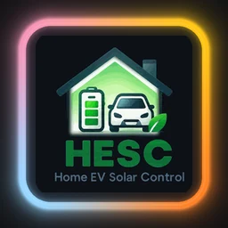
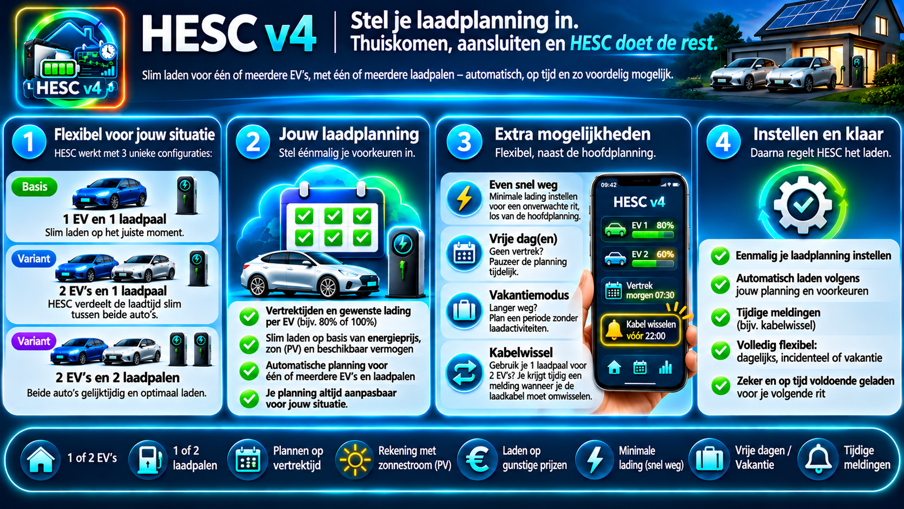
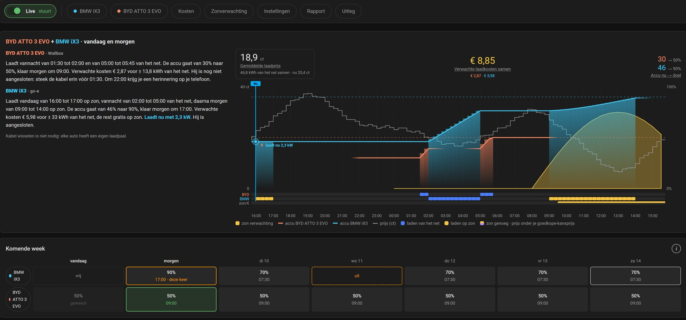
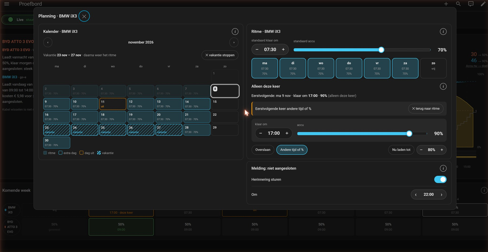
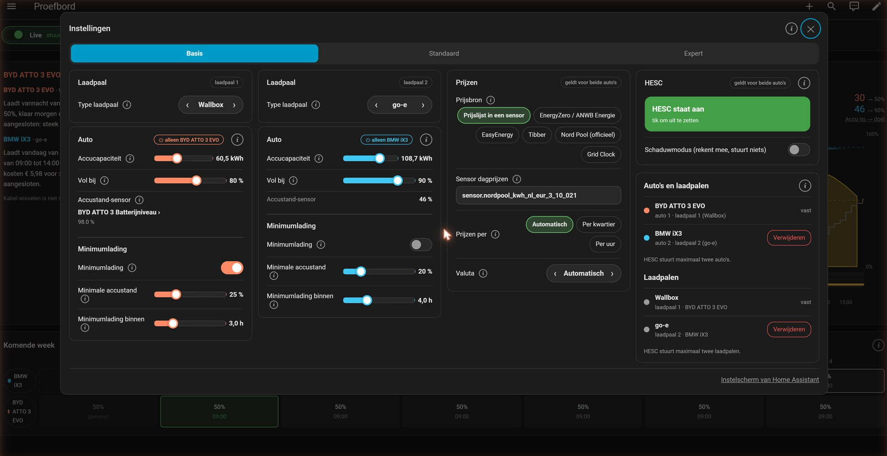
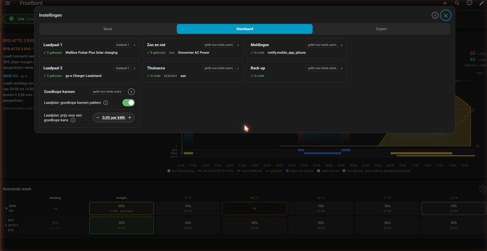
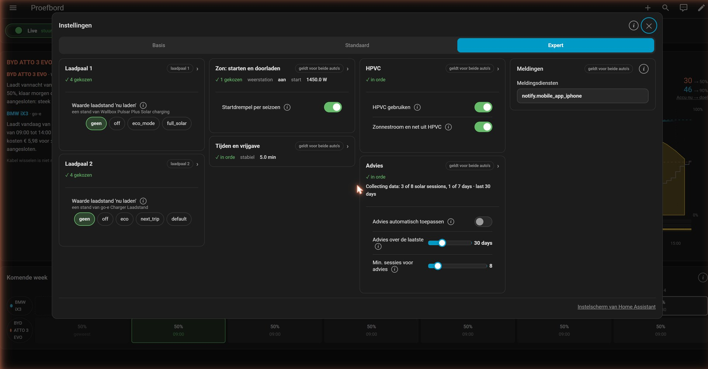
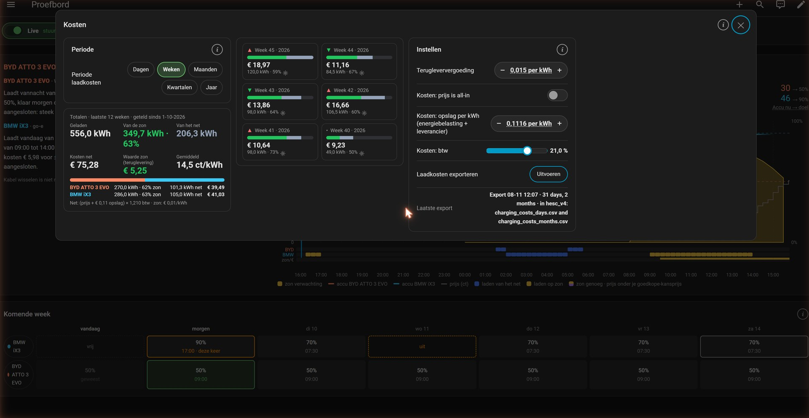
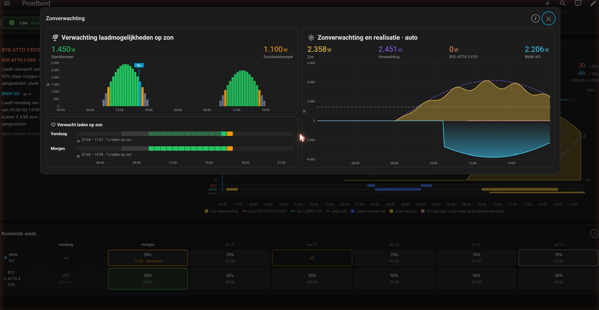
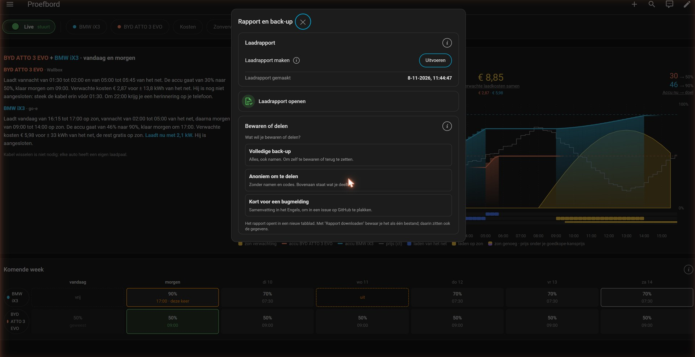

   

# HESC v4 — Smart EV Charging Management

*Stel je laadplanning in. Thuiskomen, aansluiten en HESC doet de rest.*

*English: [README.md](README.md) · Deutsch: [README.de.md](README.de.md)*

HESC laadt je elektrische auto zoveel mogelijk met je eigen zonnestroom, en van het net op de
goedkoopste momenten als de zon niet genoeg is. HESC v4 is de opvolger van HESC v3: eenvoudiger in
te stellen, met een eigen paneel in Home Assistant en met **twee auto's en twee laadpalen**.

> **Release candidate (RC1).** HESC v4 is de opvolger van de HESC v3-serie. Overstappen van v3 en weer terug kan altijd, zie [Installeren](#1-installeren).

Het paneel volgt de taal van je Home Assistant-profiel: Nederlands, Duits, en Engels voor alle andere talen.

## Inhoud

1. [Installeren](#1-installeren)
2. [De eerste start](#2-de-eerste-start)
3. [Wat HESC zelf vindt en wat je zelf invult](#3-wat-hesc-zelf-vindt-en-wat-je-zelf-invult)
4. [Eén of twee auto's, één of twee laadpalen](#4-één-of-twee-autos-één-of-twee-laadpalen)
5. [Het paneel](#5-het-paneel)
6. [Planning](#6-planning)
7. [Instellingen](#7-instellingen)
8. [HESC aan, uit en schaduw](#8-hesc-aan-uit-en-schaduw)
9. [Kosten, zonverwachting en rapport](#9-kosten-zonverwachting-en-rapport)
10. [Wat nog niet klaar is](#wat-nog-niet-klaar-is)

## 1. Installeren

1. Zoek **HESC** in HACS en installeer de nieuwste versie. Herstart Home Assistant.
2. *Instellingen → Apparaten & diensten → Integratie toevoegen → HESC v4*.
3. Eén vraag: **HESC v4 installeren?** Heb je HESC v3, dan kun je ook de instellingen van v3 overnemen.
4. In de zijbalk verschijnt **HESC v4**. Daar begint de eerste start.

**Van v3 naar v4, en terug.** HESC v4 komt naast v3 te staan; er wordt niets weggegooid. Neem je de
instellingen van v3 over, dan zet v4 de oude v3 daarna op pauze, zodat er altijd maar één de laadpaal
bedient. Wil je terug: *Instellingen › Expert › Meldingen › Terug naar v3* zet v3 weer aan en v4 op pauze.
Staat v3 niet meer in HACS, kies daar dan eerst een v3-versie.

HESC staat na het installeren in **schaduwmodus**: hij rekent en laat zien wat hij zou doen, maar
schakelt niets. Pas na de eerste start kun je de schaduwmodus uitzetten.

## 2. De eerste start

De eerste start vraagt eerst een paar dingen en daarna alleen wat HESC zelf niet vond.

1. **Hoe laad je thuis?** Eén auto · twee auto's op één laadpaal · twee auto's met elk een eigen laadpaal.
2. **Je huis.** Aansluiting (1 of 3 fasen, ampère), loadbalancer, zonnepanelen, dynamische prijzen, en
   de bevestiging dat je installatie het laden aankan.
3. **Laadpaal.** Kies het merk. Heb je twee laadpalen van hetzelfde merk, dan kies je welke welke is.
4. **Auto.** Naam, kleur en accucapaciteit (die laatste alleen als de auto hem niet zelf meldt).
5. **Wat HESC niet vond.** Bijvoorbeeld de accustand-sensor of de prijzen.

Bij een Wallbox met één auto zijn dat ongeveer 9 tikken.

## 3. Wat HESC zelf vindt en wat je zelf invult

| Onderdeel | Plug-and-play | Zelf invullen |
|---|---|---|
| Laadpaal | Wallbox, Peblar, Alfen, go-e, Wattpilot, SMA, evcc, Ohme | Zappi en Easee vragen iets meer; *Anders* helemaal zelf |
| Zonnestroom, slimme meter | meestal gevonden; HESC doet een **voorstel** | als het voorstel niet klopt |
| Zonverwachting | Solcast en andere verwachtingen worden gevonden | — |
| Prijzen | eerst je land, dan de bronnen van dat land: Grid Clock, EnergyZero/ANWB, EasyEnergy, Tibber, Zonneplan, Nord Pool, EPEX Spot, ENTSO-e, PVPC, OMIE, Energi Data Service, Octopus Energy, Amber Electric | *Eigen sensor met prijslijst*: kies de sensor |
| Accucapaciteit | als de auto hem meldt | anders typ je hem in |
| Thuisbatterij(en) | HESC zoekt je batterijen en doet een voorstel | stap voor stap bevestigen (per batterij, of één totaal-sensor) |
| Weerstation | — | zelf aanzetten en de sensor kiezen |

Bij elke instelling staat een kleine **(i)** met één of twee zinnen uitleg.

## 4. Eén of twee auto's, één of twee laadpalen

- **Eén auto, één laadpaal.** De gewone situatie.
- **Twee auto's, één laadpaal.** HESC plant beide auto's: de eerste vóór het tijdstip waarop je de kabel
  omzet, de andere erna. Het overzicht zegt wanneer je wisselt; een herinnering op je telefoon kan
  (*Instellingen › Standaard › Kabel omzetten*).
- **Twee auto's, twee laadpalen.** Elke auto heeft zijn eigen laadpaal; zelfde merk of verschillend.

Toevoegen en verwijderen doe je in *Instellingen › Basis › Auto's en laadpalen*:
- **+ Auto toevoegen** — een tweede auto, op dezelfde laadpaal of met een eigen.
- **+ Laadpaal toevoegen** — als twee auto's één laadpaal delen, krijgt auto 2 een eigen laadpaal.
- **Verwijderen** — alleen auto 2 en laadpaal 2. HESC laat eerst zien wat er weggaat en vraagt om
  bevestiging. Laadkosten en geschiedenis worden niet gewist maar bewaard.

## 5. Het paneel

Bovenaan een rij knoppen: **Live · stuurt** (schaduwmodus), de planning per auto, **Kosten**,
**Zonverwachting**, **Instellingen**, **Rapport** en **Uitleg**.

**Vandaag en morgen** — links een korte brief per auto (wanneer hij laadt, van zon of net, tot welk
% en wat het kost), rechts de grafiek met zonverwachting, prijs en de laadmomenten per auto.
**Komende week** — per auto de komende zeven dagen; tik een auto of dag aan om de planning te openen.

## 6. Planning

- **Ritme** — een standaard klaar-tijd en accu-%, per weekdag aan of uit, of met een eigen tijd of %.
- **Alleen deze keer** — de eerstvolgende keer overslaan, een andere tijd of %, of **nu laden**.
- **Kalender** — losse dagen uit of extra, en vakantie (sleep van de eerste naar de laatste dag).
- **Eigen dag** — dubbeltik op een dag (ook een lege) voor een eigen tijd en laaddoel op die dag.
- **Melding: niet aangesloten** — een herinnering als de auto 's avonds niet aan de laadpaal hangt; niet
  als de auto het laatste uur al vol genoeg gemeld is.
- **Op je telefoon** — maand en ritme staan op eigen pagina's; je kunt kiezen dat HESC op de maand opent.

**Nu laden is beveiligd.** De pijltjes kiezen alleen het doel. Pas na **Start** en de bevestiging
laadt HESC van het net. Stoppen kan altijd.

## 7. Instellingen

Drie tabbladen:

- **Basis** — laadpaal, auto('s), prijzen, HESC aan/uit en *Auto's en laadpalen*. Bij twee auto's staan
  ze naast elkaar. Het labeltje **⏻** bij een auto zet HESC voor die auto aan of uit.
- **Standaard** — tegels: Laadpaal 1 (en 2), Zon en net, Thuisbatterij(en), Meldingen, Back-up en Goedkope
  kansen. Een tegel laat zien of alles in orde is (✓) of wat ontbreekt (⚠); tik erop voor de details.
  Zon en net, Thuisbatterij(en), Goedkope kansen en Meldingen hebben **Stap voor stap instellen**: één
  vraag per scherm, het voorstel van HESC al aangevinkt, live waarden en een samenvatting voor het opslaan.
- **Expert** — tegels voor de fijnere afstelling: Laadpaal, Zon: starten en doorladen (met het
  weerstation), Tijden en vrijgave, HPVC, Advies en Meldingen. Wat je vaak wijzigt staat op de tegel zelf.
  Onder *Meldingen* staan ook **Eerste start opnieuw doorlopen** en **Terug naar v3**.

**Prijzen.** Kies eerst je land; dat zet ook de munteenheid. Daarna zie je alleen de prijsbronnen van
dat land die bij jou geïnstalleerd zijn, met één tik te kiezen. Wat nog ontbreekt, noemt HESC eronder.

**Fasen.** Bij 3 fasen met een meter per fase laat *Zon en net* zien hoe je zon over de fasen verdeeld is,
nu en gemiddeld (bijvoorbeeld 40% · 38% · 22%). *Expert › Advies › Fasen-overzicht* laat per fase zien of
die genoeg zon krijgt voor je laadpaal, en wat je eraan kunt doen.

**Sensoren kiezen.** Tik op een sensorvak: je krijgt een korte lijst, met bovenaan wat nu gekozen is en
het **voorstel** van HESC. Na OK slaat HESC het meteen op. De standen van je laadpaal voor *laden op zon* en *geen auto* vink je aan.

## 8. HESC aan, uit en schaduw

| Schakelaar | Wat het doet |
|---|---|
| **HESC staat aan** (Basis) | Hoofdschakelaar. Uit = HESC doet niets. |
| **Schaduwmodus** (Basis en *Live · stuurt*) | HESC rekent en laat zien wat hij zou doen, maar stuurt niets. |
| **⏻ per auto** (Basis, bij de auto) | Uit = HESC plant nog voor die auto, maar stuurt die auto en zijn eigen laadpaal niet. Een andere auto gaat gewoon door. |

## 9. Kosten, zonverwachting en rapport

- **Kosten** — wat het laden kostte, per dag, week, maand en jaar, van zon en van het net; bij twee
  auto's per auto. *Laadkosten exporteren* zet de kosten in twee CSV-bestanden in de map hesc_v4; met *Laadkosten downloaden* haal je ze binnen.
- **Zonverwachting** — zon verwacht tegen werkelijk, en wanneer de auto met zonne-energie kan laden.
- **Rapport** — het **laadrapport** (hoe ging het laden op zon, per dag, met advies), en **bewaren of
  delen**: volledige back-up, anoniem om te delen, of kort voor een bugmelding. De volledige back-up staat
  in een eigen map (`/config/hesc_backup`), zodat hij blijft bestaan als je HESC verwijdert.

## Wat nog niet klaar is

- Namen van je eigen apparaten en sensoren komen uit Home Assistant, in de taal die jij daar gebruikt.
- De nieuwe prijsbronnen (EPEX Spot, PVPC, OMIE, Energi Data Service, Octopus Energy, Amber Electric, Zonneplan,
  ENTSO-e) zijn getest met hun lijstvorm, nog niet op een echte installatie. Werkt jouw bron niet, meld het dan.

Schermafbeeldingen (van beta.1): proefbord met demo-gegevens (verzonnen auto's, prijzen en laadgeschiedenis). Ook in het
[Engels](docs/images/v4/en/) en [Duits](docs/images/v4/de/).

## Steun dit project

Vind je HESC handig? Geef het een ⭐ op GitHub, dan vinden anderen het ook.

Wil je iets meer doen? Steun me via [Ko-fi](https://ko-fi.com/satscan).

## Licentie

[GPL-3.0](LICENSE)
