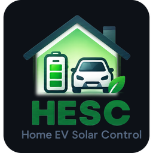

# HESC — Home EV Solar Control

*English: [README.md](README.md) · Deutsch: [README.de.md](README.de.md)*

HESC laadt je elektrische auto zoveel mogelijk met je eigen zonnestroom, en van het net op de
goedkoopste momenten als de zon niet genoeg is. HESC draait in Home Assistant.

## Wat HESC doet

- **Laadt op zon.** HESC volgt je zonverwachting en je zonnestroom en laat de laadpaal op het
  juiste moment op zon starten.
- **Plant netladen.** Vertel HESC wanneer de auto klaar moet zijn en hoe vol. HESC kiest met
  dynamische prijzen de goedkoopste kwartieren en houdt rekening met de zon die nog komt.
- **Werkt samen met je thuisbatterij.** Als de thuisbatterijen alle zon zouden pakken, geeft HESC
  de auto een kickstart. Zo komt de auto aan de beurt en hoeft hij niet te wachten tot de
  batterijen vol zijn. HESC regelt de thuisbatterij nooit zelf: dit werkt met een batterij die
  reageert op wat het huis verbruikt (zie [Hoe het werkt](docs/04-how-it-works.nl.md#thuisbatterij-en-auto-kickstart)).
- **Laat zien wat er gebeurt.** Een dashboard met vandaag, de verwachting, kosten en advies, en
  een rapport dat je altijd kunt openen.

## Nieuw in v3

HESC v3 is een Home Assistant-integratie. Hij kan alles wat HESC v2 kan, en daarnaast:

- **Geen Node-RED en geen YAML-package meer.** Je installeert één integratie en vult één
  instelscherm in.
- **Vindt je laadpaal en auto zelf**, ook als Home Assistant Nederlandse of Duitse entiteitnamen gebruikt.
- **Werkt ook zonder zonverwachting** als je die niet hebt (Solcast, Open-Meteo en
  Forecast.Solar worden ondersteund).
- **Past de laadstroom aan** bij laadpalen die dat toestaan, zodat er meer zon in de auto gaat.
- **Kent het startniveau van je laadpaal.** Het advies komt nooit lager uit dan wat je laadpaal
  nodig heeft om op zon te starten.
- **Fase-advies** als je meter het vermogen per fase toont: HESC laat zien of één fase je
  laadpaal tegenhoudt.
- **Het dashboard komt met HESC mee**: *HESC* in de zijbalk, niets te plakken.
- **Nu laden** tot een stand die jij kiest, van het net, daarna vanzelf terug naar zon.
- **Eén dag overslaan** in het weekplan (een vrije dag), zonder het plan te veranderen.
- **Op je telefoon en horloge** (iPhone, Apple Watch, Android, Wear OS): een samenvatting van één
  regel voor een widget, acties voor Siri en Opdrachten, en knoppen voor één tik. Zie
  [Dashboard](docs/06-dashboard.nl.md#op-je-telefoon-en-horloge).

HESC v2 blijft beschikbaar. Je kunt v3 naast v2 laten draaien en overstappen als je eraan toe
bent; zie [Overstappen van v2](docs/02-upgrade-from-v2.nl.md).

## Hoe HESC getest wordt

Elke versie wordt vóór de release getest in een simulator die hele dagen in seconden afspeelt:
vaste scenario's (zonnige zomerdag, bewolkte winterdag, negatieve prijzen, een laadpaal die niet
wil starten, een herstart midden in een plan, …) en echte, opgenomen dagen, voor elke
ondersteunde laadpaal. Een nieuwe versie moet hetzelfde beslissen als de vorige, tenzij de
wijziging zo bedoeld is.

## Wat je nodig hebt

- Home Assistant **2026.10.1** of nieuwer.
- Je **laadpaal** in Home Assistant, via de eigen integratie van de laadpaal.
- De **accustand van je auto** in Home Assistant (aanbevolen). HESC werkt ook zonder, maar plant
  nauwkeuriger mét.
- Naar keuze: een **zonverwachting**, **dynamische energieprijzen**, een **thuisbatterij**, en
  [Home PV Control (HPVC)](https://github.com/BioPC/home-pv-control) 1.5.1 of nieuwer.

## Installeren in drie stappen

1. Installeer de integratie (via HACS of met de hand).
2. Voeg **HESC v3** toe onder *Instellingen → Apparaten & diensten* en vul het
   instelscherm in.
3. Open **HESC** in de zijbalk: het dashboard en de kaarten komen met HESC mee, verder niets te installeren.

HESC begint in **schaduwmodus**: hij kijkt mee en laat zien wat hij zou doen, maar schakelt niets
tot jij de schaduwmodus uitzet. Stap voor stap: [Installatie](docs/01-installation.nl.md).

## Handleiding

| | English | Nederlands | Deutsch |
|---|---|---|---|
| Installatie | [01-installation](docs/01-installation.md) | [01-installatie](docs/01-installation.nl.md) | [01-installation](docs/01-installation.de.md) |
| Overstappen van v2 | [02-upgrade-from-v2](docs/02-upgrade-from-v2.md) | [02-overstappen-van-v2](docs/02-upgrade-from-v2.nl.md) | [02-umstieg-von-v2](docs/02-upgrade-from-v2.de.md) |
| Instellingen | [03-settings](docs/03-settings.md) | [03-instellingen](docs/03-settings.nl.md) | [03-einstellungen](docs/03-settings.de.md) |
| Hoe het werkt | [04-how-it-works](docs/04-how-it-works.md) | [04-hoe-het-werkt](docs/04-how-it-works.nl.md) | [04-so-funktioniert-es](docs/04-how-it-works.de.md) |
| Laadpalen en bronnen | [05-chargers-and-sources](docs/05-chargers-and-sources.md) | [05-laadpalen-en-bronnen](docs/05-chargers-and-sources.nl.md) | [05-wallboxen-und-quellen](docs/05-chargers-and-sources.de.md) |
| Dashboard | [06-dashboard](docs/06-dashboard.md) | [06-dashboard](docs/06-dashboard.nl.md) | [06-dashboard](docs/06-dashboard.de.md) |
| Slim laden uitgelegd | [07-smart-charging-explained](docs/07-smart-charging-explained.md) | [07-slim-laden-uitgelegd](docs/07-smart-charging-explained.nl.md) | [07-intelligentes-laden-erklärt](docs/07-smart-charging-explained.de.md) |
| Een dag met HESC | [08-a-day-with-hesc](docs/08-a-day-with-hesc.md) | [08-een-dag-met-hesc](docs/08-a-day-with-hesc.nl.md) | [08-ein-tag-mit-hesc](docs/08-a-day-with-hesc.de.md) |
| Problemen oplossen | [09-troubleshooting](docs/09-troubleshooting.md) | [09-problemen-oplossen](docs/09-troubleshooting.nl.md) | [09-fehlerbehebung](docs/09-troubleshooting.de.md) |

