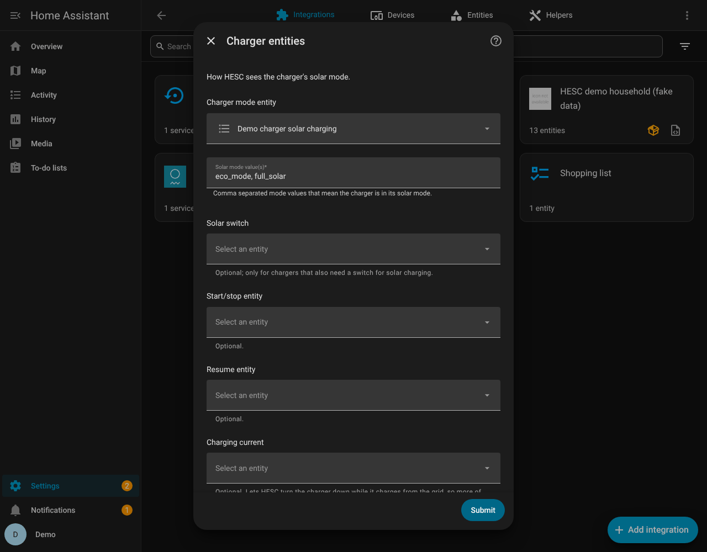
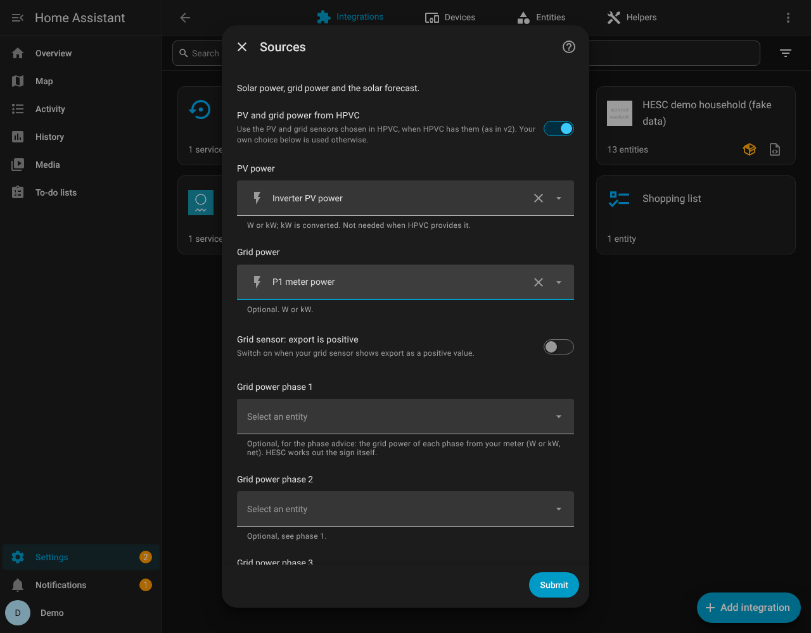
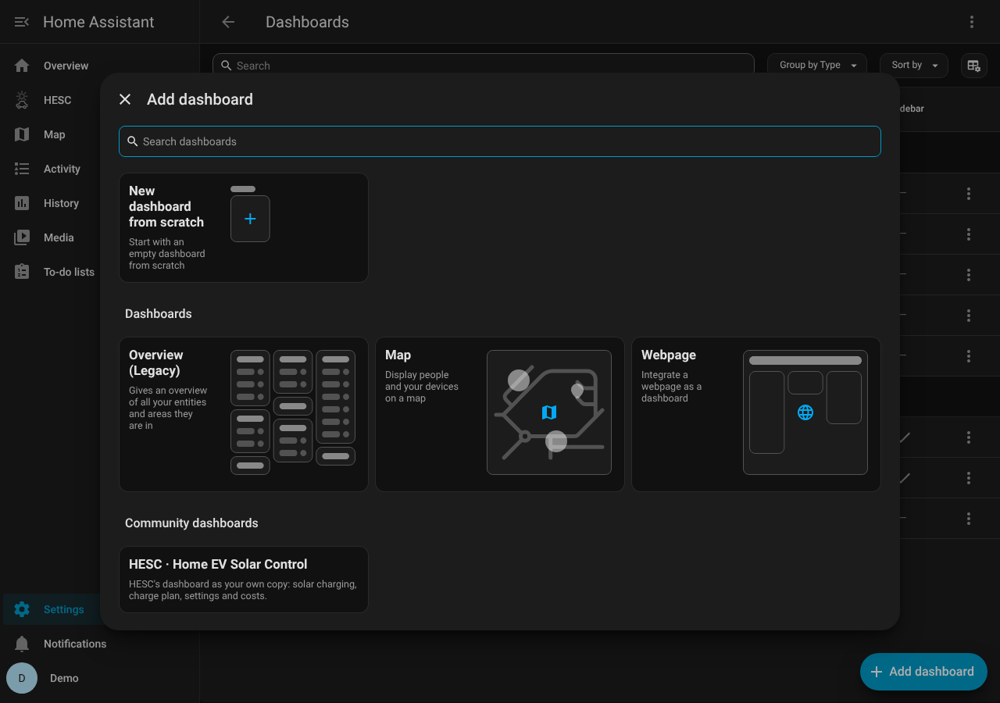
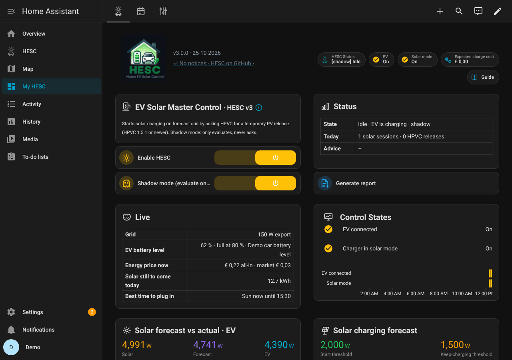
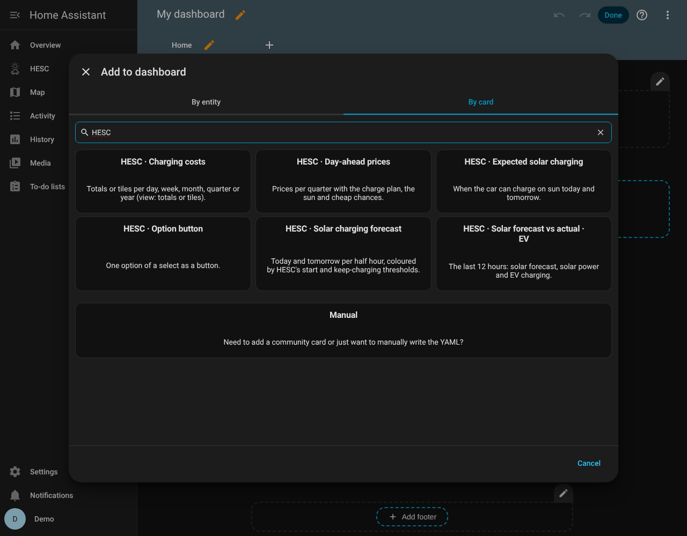

# 01 · Installation

*Nederlands: [01-installation.nl.md](01-installation.nl.md)*

**In short**
- Install the integration, add it in Home Assistant and fill in the setup screen. HESC fills in
  most of it by itself.
- The dashboard and its cards come with HESC: nothing else to install.
- HESC starts in shadow mode: it watches and shows what it would do, but switches nothing.
  Turn shadow mode off when you trust what you see.
- Coming from HESC v2? Read [02 · Upgrading from v2](02-upgrade-from-v2.md) as well.

## 0. Before you start

- **Home Assistant 2026.10.1 or newer.**
- **HACS**, to install HESC (see step 1). HESC needs no other cards from HACS.
- **Your charger** in Home Assistant through its own integration. HESC needs to see whether a car
  is connected, how much power goes into the car, and the setting that lets the charger charge on
  sun (for example Eco mode on a Wallbox).
- **One planner per charger.** Switch off charging schedules in your charger's own app or in
  other integrations while HESC plans your charging. Two planners on one charger get in each
  other's way. After an update of the charger app or firmware, check that no schedule has
  appeared by itself.
- **Your car's battery level** (recommended). Usually from the integration of your car brand.
  HESC works without it, but the charge plan is more accurate with it. A value that updates regularly
  (every few minutes) works best. When no new value comes in, HESC goes on with the last known
  level plus what was charged since.
- **Optional:**
  - a **solar forecast** — [Solcast](https://github.com/BJReplay/ha-solcast-solar) works best;
    Open-Meteo and Forecast.Solar also work. Without a forecast HESC still charges on measured
    solar power and plans the grid charging as if no sun comes;
  - **dynamic energy prices**, for the charge plan, cheap chances and the costs page;
  - a **home battery**, for the kickstart;
  - [Home PV Control (HPVC)](https://github.com/BioPC/home-pv-control) **1.5.1 or newer**, if your
    solar panels are limited for export. Without HPVC, HESC runs on its own (standalone).

## 1. Install the integration

**With HACS**
1. HACS → ⋮ → **Custom repositories** → add `https://github.com/satscan1/hesc-home-ev-solar-control`, type
   **Integration**.
2. Find **HESC - Home EV Solar Control** in HACS and click **Download**.
3. Restart Home Assistant.

**By hand**
1. Copy the folder `custom_components/hesc` from this repository to
   `/config/custom_components/hesc` on your Home Assistant.
2. Restart Home Assistant.

## 2. Add HESC and fill in the setup screen

*Settings → Devices & services → Add integration → **HESC v3***. The setup screen has five steps.
HESC searches your Home Assistant and fills in what it finds by itself. Check it and click
**Submit**.

| Step | What you choose |
|---|---|
| **Charger** | Your charger type: Wallbox, Alfen Eve, Peblar, myenergi Zappi, go-e Charger, Fronius Wattpilot, SMA EV Charger, Ohme, Easee, evcc (any charger), or *Other (manual)*. HESC then looks up your charger's entities by itself. |
| **Sources** | Where HESC gets your solar power, your grid power and the solar forecast. If you have HPVC, HESC can use HPVC's sensors (*PV and grid power from HPVC*). If your grid meter shows power **per phase**, HESC also fills in the three phase sensors; they are for the phase advice. |
| **Electric vehicle** | How HESC sees whether the car is connected, how much power goes in and how full the battery is. No battery-level sensor? The screen tells you where to find one for your car. |
| **Charger entities** | Which setting makes the charger charge on sun, how HESC starts and stops it, and the charging current (if your charger lets HESC set it). |
| **HPVC** | Work together with HPVC, or *Without HPVC (standalone)*. Without HPVC this is set to standalone by itself. |

Could HESC not fill in a field yet, for example because the charger integration was still
starting? Then it searches again once Home Assistant has fully started. You can change everything later:
*Settings → Devices & services → HESC v3 → Configure*.

<p> </p>

## 3. Add the dashboard

**The dashboard comes with HESC.** Once HESC is set up, **HESC** is in the sidebar (address
`/hesc-v3`). There is nothing to create or paste, and every HESC update brings the matching
dashboard along. HESC fills in the names of its own entities and the Solcast and HPVC sensors you
chose in the setup screen, so renaming them does not break the dashboard.

**No cards from HACS needed (since 3.0.0).** The charts, the *Expected solar charging* bar, the
Costs page and the Kiosk page use HESC's own cards. They come with the integration and are in the
card picker after a restart (search for *HESC*). Did you install apexcharts-card, button-card,
card-mod or kiosk-mode for HESC before? HESC no longer uses them; keep them if other dashboards
need them.

**Your own copy, with one click.** HESC's dashboard cannot be changed in the dashboard editor. Want
a version of your own (other pages, other cards)?

1. *Settings → Dashboards → Add dashboard*.
2. Under *Community dashboards*, choose **HESC · Home EV Solar Control**, give it a name and
   *Create*.
3. Your copy has the same pages, with the buttons between the pages pointing at your copy. As long
   as you do not change it, it follows every HESC update. To change it: the pencil at the top right
   (*Edit dashboard*) *→ ⋮ → Take control*. From then on it is yours and no longer follows HESC.

Not in the list? Make a new empty dashboard (*New dashboard from scratch*), open it, tap the
pencil at the top right and choose *⋮ → Raw configuration editor*. Replace everything with these
two lines and save:

```yaml
strategy:
  type: custom:hesc
```

- **Already have a dashboard at `/hesc-v3`** (one you pasted yourself, for example as a tester)?
  Then HESC leaves it alone and shows a notice under *Settings → Repairs*. To switch to the
  dashboard that comes with HESC: delete your own one under *Settings → Dashboards*, then reload
  HESC (*Settings → Devices & services → HESC v3 → ⋮ → Reload*) or restart Home Assistant.

The HESC icons and logo come with the integration; nothing to install.

**Solcast users:** the charts use 30-minute blocks. In Solcast: *Configure → Attribute
breakdown → add `attr_brk_halfhourly`*. Without it HESC uses the hourly forecast.

<p>  </p>

## 4. Watch first, then go live

After installing, HESC is in **shadow mode**: it reads everything and shows on the dashboard what
it would do, but it does not control your charger or HPVC.

1. Let it run for some charging days. Look at *Main* and press **Generate report** (under
   Status) now and then.
2. Check that the moments HESC would start on sun make sense, and that the charge plan picks the
   quarters you expect.
3. Then switch **Shadow mode (evaluate only)** off on *Main*. From that moment HESC really controls your charger.

## Where HESC keeps its files

HESC keeps its history, the price history for the price forecast, the battery level at plug-in,
the phase measurements and the settings back-up in `/config/hesc_v3/`. These files stay when
you update HESC.

## Updating

**HACS:** download the update, restart Home Assistant. **By hand:** replace the folder
`custom_components/hesc`, restart. Your settings and history stay.

## Removing

*Settings → Devices & services → HESC v3 → ⋮ → Delete*, then remove the integration in HACS (or
the folder `custom_components/hesc`) and restart. The folder `/config/hesc_v3/` with your history
stays; delete it yourself if you no longer need it. The dashboard that comes with HESC goes away
with it.
