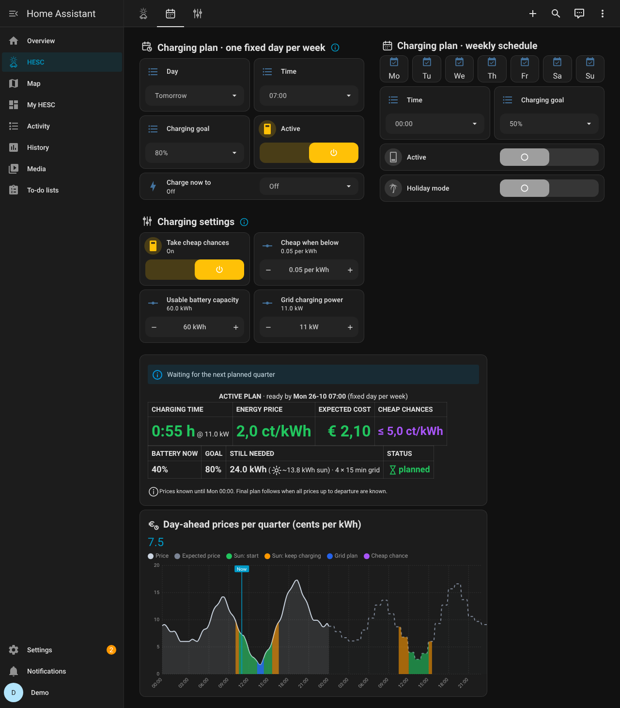

# 06 · Dashboard

*Nederlands: [06-dashboard.nl.md](06-dashboard.nl.md)*

**In short**
- The dashboard has three tabs: *Main* (what happens now), *Charge plan* (when the car must be
  ready) and *Settings*. Next to them: the *Costs* page, the *Guide* and a *Kiosk* page for a wall
  tablet.
- Most of it you only read. You change things on *Charge plan* and *Settings*, and in the setup
  screen.
- The dashboard comes with HESC (sidebar: **HESC**). The cards it needs: [01 · Installation](01-installation.md#3-add-the-dashboard).

## Main


### Top

- **Version:** the HESC version that is running, next to the logo.
- **Notice line:** *✓ No notices*, or the most important notice with its time. Red = the charge
  goal is at risk (also sent to your phone), orange = a sensor is missing but HESC keeps working,
  grey = just so you know. Tap it to go where you can act.
- **Badges:**
  - *HESC Status*, *EV* (plugged in?), *Solar mode* (is the charger set to charge on sun?) and
    *HPVC limiting*;
  - *Release*, only while HESC has asked HPVC to let the sun through;
  - *Expected charge cost*: what the active plan is expected to cost from the grid;
  - *Costs*: opens the Costs page (only when it is switched on in *Settings*);
  - *Guide*: opens the guide. Hold it for the Dutch version.

### EV Solar Master Control

- **Enable HESC:** the main switch. Off means HESC evaluates nothing at all.
- **Shadow mode (evaluate only):** HESC evaluates and shows everything, but switches nothing.
  Always start here.
- **HPVC released PV:** appears while HPVC lets the sun through for the car.

### Status

- **State:** what HESC is doing now, and why.
- **Last action:** the last thing HESC did.
- **Today:** the number of sessions on sun and HPVC releases today.
- **Advice:** the start threshold HESC advises from your own sessions that started while HPVC
  limited your panels, next to the threshold of now. Tap it to go to *Settings*.
- **Generate report** below it builds a report with everything HESC measured and decided. When
  it is ready, the button changes into **View report**.

### Live

The values of right now:

| Line | What it shows |
|---|---|
| **Grid** | how much you export to the grid or import from it |
| **Home batteries** | their power (positive = charging) and their average level; only with *Home battery and EV* filled in |
| **EV battery level** | the car's level, *EV counts as full at*, and where the value comes from |
| **Energy price now** | the all-in price and the market price; only with energy prices set up |
| **Solar still to come today** | how many kWh the sun is still expected to bring today |
| **Best time to plug in** | the next period with enough sun to start charging on sun (the green in the charts), for example *Sun tomorrow 11:00–17:30*; when no such sun is expected, the cheapest grid hour of the known prices instead |

### Current state

Whether the car is plugged in, the charger is set to charge on sun, HPVC is limiting your panels
and a release is running, with a timeline of the last 12 hours below it. With *Home battery and
EV* switched on and the car plugged in, an extra line shows what the kickstart is doing.

### Solar forecast vs actual · EV

The last 12 hours. On top: solar power, forecast and EV charging power now.

- purple: the forecast;
- orange: what your panels really produced;
- blue, below the zero line: what went into the car;
- the dashed line: the start threshold.

### Expected solar charging opportunities

The expected sun for today and tomorrow, per half hour. On top: the **Start threshold** and the
**Keep-charging threshold**. Green bars = enough sun to start charging, orange = enough to keep
charging but not to start, grey = too little. *Now* marks the current moment.

### Expected solar charging

When the car is expected to charge on sun today and tomorrow, between sunrise and sunset, and for
how many hours.

## Charge plan



- **Charging plan · one fixed day per week:** a day, a time and a charging goal, for example
  100 % on Friday at 08:00. It comes back every week. *Active* switches it on or off.
- **Charging plan · weekly schedule:** tick the days (*Mo* … *Su*), pick a time and a charging goal, for example
  80 % on weekdays at 07:00. When both plans are active, the earliest one wins.
- **Holiday mode:** the weekly plan rests while you are away; the one-day plan and charging on
  sun carry on. *Holiday until (optional)*: the day after that date it switches itself off.
- **Skip one day (day off):** pick a date and the weekly plan does nothing on that day; the next
  day of the plan counts instead. The plan itself stays as it is. Shown while the weekly plan is on.
- **Charge now to:** charges from the grid at once until the car reaches the chosen level, then the
  charger goes back to its own solar mode. It stops by itself when the goal is reached, the car is
  unplugged, or after the expected charge time × 1.5 plus one hour. It needs grid charging set up
  (*Settings → Plan and notifications*) and the car's battery level; not within 3 % of the goal, not in shadow
  mode.
- **Charging settings:**
  - *Take cheap chances* and *Cheap when below* — also charge without a plan when the price is
    very low;
  - *Usable battery capacity* and *Grid charging power* — what your car really holds and what
    your charger delivers from the grid.
- **Plan status:** what HESC is doing for which plan and until when: charging time, average
  energy price, expected cost, battery level now, goal, what is still needed and the status. With
  cheap chances on, your price limit shows in purple. Without an active plan the card only says
  *No charging plan active*.
- **Price chart:** the price for today and tomorrow as a smooth line: light grey = the price,
  dashed with an almost empty area = an expected price (tomorrow's real prices are not known yet). Coloured areas under
  the line show when it pays to have the car connected: green = enough sun expected to start
  charging on sun (*Sun: start*), amber = enough sun to keep charging, no new start (*Sun: keep
  charging*), blue = grid plan, purple striped = a cheap chance. When a cheap chance falls in a
  sunny period you see the green through the purple stripes.

## Settings


Three columns: **1 · Your charger**, **2 · Sources** and **3 · Advanced**. Most fields come from
the setup screen; the button *Change sources and charger* opens it.

**1 · Your charger**
- *Charger type* and *Search again* — HESC looks up the entities of your charger.
- *Charger fields* — what HESC uses; they open by themselves when something is missing.
- **Setup check** — one line per part with a tick. A part that is wrong opens and says what is
  missing.
- **Advice** — the start threshold of now and the advice. Under it the line *Phases* with the
  phase advice, if you chose the grid power per phase. *Apply advice automatically* lets HESC move
  the threshold towards the advice in small steps. Without HPVC there is no threshold advice, so
  this card then only shows the threshold of now and the switch is hidden.
- **Your settings** — your thresholds, car, timing, charge plan and advice settings at a glance.
- *Back up settings*, *Restore back-up*, *Standard values*.
- **Charging costs** — *Use* shows the Costs page; *Settings* shows the value of a solar kWh,
  *all-in*, or mark-up and VAT.

**2 · Sources**
- *Use HPVC* — switch on when you use HPVC (off by default).
- *PV & grid from HPVC* — take HPVC's solar and grid sensors. Only when HPVC sees all your
  panels. Off puts your own sensors back.
- *Change sources* — shows the solar, grid and forecast sensors and the HPVC entities.
- *Show optional fields* — for example *EV counts as full at* and the values that mean "no car".
- **Local weather station** — *Use* and *Settings* (irradiance sensor and its thresholds, and
  which solar forecast HESC uses).

**3 · Advanced — only if needed**
- *Charging thresholds* — the start and keep-charging thresholds, *Start threshold per season*, and *EV
  counts as charging above*.
- *Timing* — how long HESC waits at each step of a release.
- *Advice* — over how many days and from how many sessions.
- *Plan and notifications* — start/stop switch, *Back to solar mode*, the "charge now" value, price source,
  price sensor, *Prices per*, currency, the final check, phones for notifications (with a test
  button) and the morning summary.
- **Minimum charge** — *Use* and *Settings*: keep the car at least at a level, in the cheapest
  quarters.
- **Home battery and EV** — *Use* and *Settings*: level and power sensors of the home batteries,
  their size, *Kickstarts per day* and *Minimum sun left for the EV*.

More about each setting: [03 · Settings](03-settings.md).

## Costs


Opened with the *Costs* badge on *Main*, when the costs page is switched on in *Settings*.

- **Period:** *Days*, *Weeks*, *Months*, *Quarters* or *Year*.
- **Totals:** how many kWh went into the car, from the sun and from the grid, what the grid part
  cost, and the value of the solar kWh.
- **Tiles:** one per day (or week, month …), with the kWh from sun (green) and grid (grey) and
  the cost.
- **Export to spreadsheet (CSV):** writes two files, per day and per month, that open in Excel.

## Guide and Uitleg

The guide built into the dashboard, in English (*Guide*) and Dutch (*Uitleg*). The same text as
[07 · Smart charging explained](07-smart-charging-explained.md). The ⓘ next to a heading opens
it too.

## Kiosk


A page for a tablet on the wall: both plans and the plan settings, what HESC does now, the plan
status and the live values. Open `/hesc-v3/kiosk` on the tablet. The Home Assistant menu and top
bar are hidden on this page; add `?disable_km` to the address to keep them. No extra card is
needed (since 3.0.0). After a Home Assistant restart the page refreshes itself.

See also: [05 · Chargers and sources](05-chargers-and-sources.md) ·
[09 · Troubleshooting](09-troubleshooting.md)

## On your phone and watch


HESC works with the Home Assistant app on an iPhone or an Android phone, also away from home. What
you can do is the same on both; only the buttons on the phone differ.

**What HESC offers (both phones)**

- The sensor *Summary for phone and watch*: one line, for example *EV 72% → 80% by Sat 24-10 07:00 ·
  Charging on sun · grid Fri 02:00*, or *EV 91% · not plugged in*. Its attributes hold the separate
  values (battery level, goal, ready by, next grid quarter, plugged in, charge now) for your own
  templates.
- Actions:
  - **HESC: Set charge plan** (`hesc.set_charge_plan`: day, time, goal — each optional; the time is
    a whole or half hour). Setting a plan switches it on.
  - **HESC: Charge plan off** (`hesc.charge_plan_off`).
  - **HESC: Charge now** (`hesc.charge_now`: goal) and **HESC: Stop charge now**
    (`hesc.charge_now_off`).
  - **HESC: Skip a day of the repeating plan** (`hesc.skip_plan_day`: date, optional — left out, the
    next day of the weekly plan) and **HESC: Undo skipping a day** (`hesc.undo_skip_plan_day`).
- Ready-made buttons for one tap: *Charge now to the plan goal*, *Stop charge now*, *Skip the next
  day of the weekly plan*, *Undo skipping a day* and *Charge plan off*.
- **Notifications:** choose your phone on the *Settings* page.

A phone widget, a quick-settings tile or a watch can press one of these buttons or start a *script*.
For anything else (another goal, another time), put the action in a script of its own (*Settings →
Automations & scenes → Scripts*). For example, in YAML:

```yaml
hesc_charge_tomorrow_0700_95:
  alias: "HESC: charge for tomorrow 07:00 to 95 %"
  sequence:
    - action: hesc.set_charge_plan
      data: {day: Tomorrow, time: "07:00", goal: 95}
hesc_charge_now_to:
  alias: "HESC: charge now to"
  fields:
    goal:
      default: 80
      selector: {number: {min: 50, max: 100, step: 5, unit_of_measurement: "%"}}
  sequence:
    - action: hesc.charge_now
      data: {goal: "{{ goal | int(80) }}"}
hesc_skip_next_day:
  alias: "HESC: skip the next day of the weekly plan"
  sequence:
    - action: hesc.skip_plan_day
```

**iPhone and Apple Watch**

- **Widget or watch:** add *Summary for phone and watch* as a widget or as a watch complication in the
  Home Assistant app.
- **Siri or Shortcuts:** make a shortcut with the Home Assistant action *Perform action* (one of the
  HESC actions above) or *Run script*. Then say for example *Hey Siri, charge the car for tomorrow*.
- **Lock screen:** the *Details* and *Gauge* widgets refresh when they get a silent notification. HESC
  sends one to the iPhones and iPads in its phone list when something in the summary changes
  (plugged in, plan, goal, charging, battery level per 10 %), at most once every 20 minutes, so the
  daily budget iOS gives these refreshes is never used up. Home-screen widgets refresh about every
  15 minutes; iOS decides that. Not in shadow mode.

**Android phone and Wear OS watch**

- **Widget:** the *Entity state* widget with *Summary for phone and watch*, or the *Template* widget
  for your own text. Android widgets refresh by themselves: every 30 minutes while the screen is on,
  or at once when you let the Home Assistant app read notifications with *Real-time* on (Android
  settings; uses a little more battery). HESC sends Android phones no refresh notification; it is
  an iOS command and would show up as a message.
- **One tap:** the *Action button* widget, or a *quick-settings tile* (in the app: *Settings →
  Companion app → Manage tiles*), each pressing one of the HESC buttons or running one of your HESC
  scripts.
- **Voice:** set the Home Assistant app as the phone's assistant and ask Assist to run a HESC script.
- **Wear OS watch:** a *Shortcuts* tile with the HESC buttons or your HESC scripts, and an *Entity state* complication
  with *Summary for phone and watch*.

The Android part follows the Home Assistant Companion documentation; it has not been tried on an
Android phone yet.
