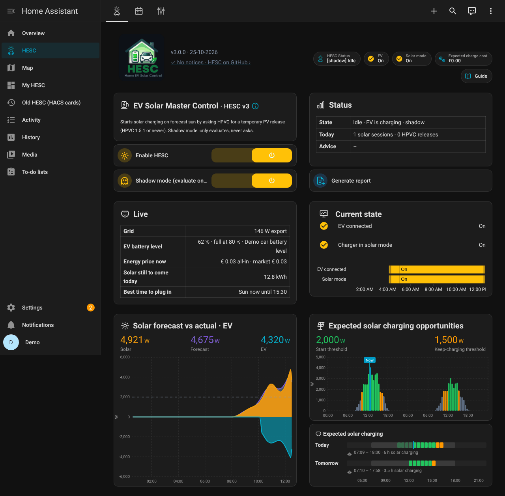
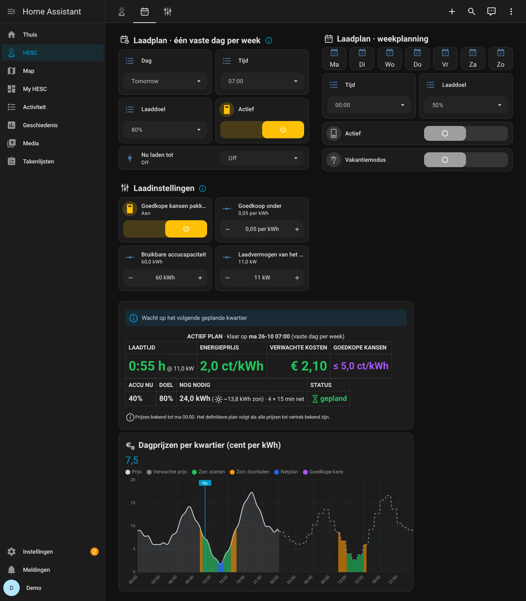
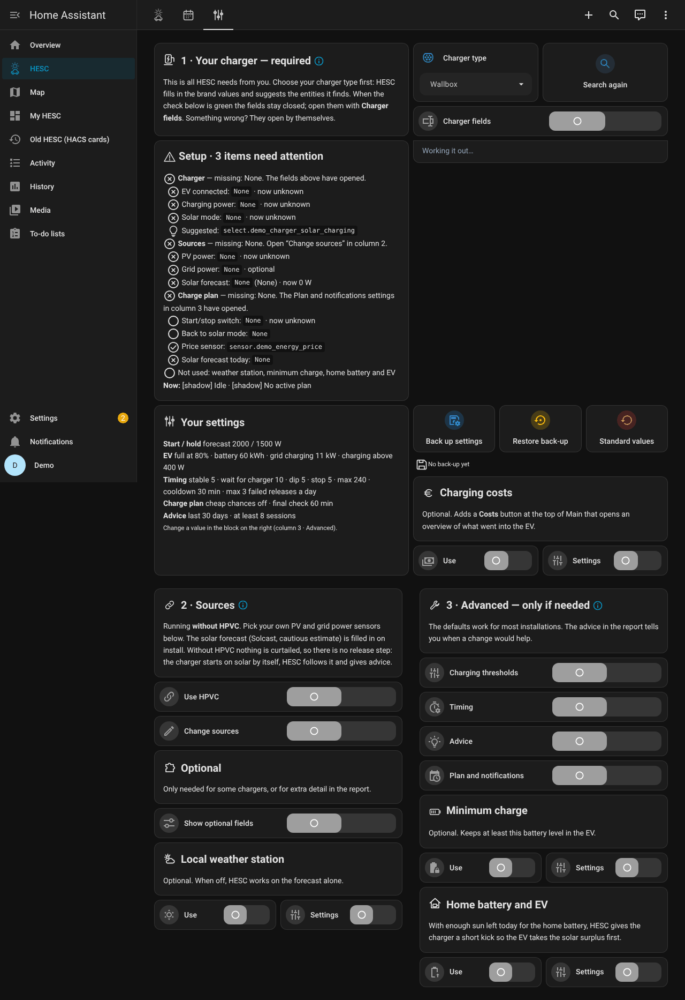
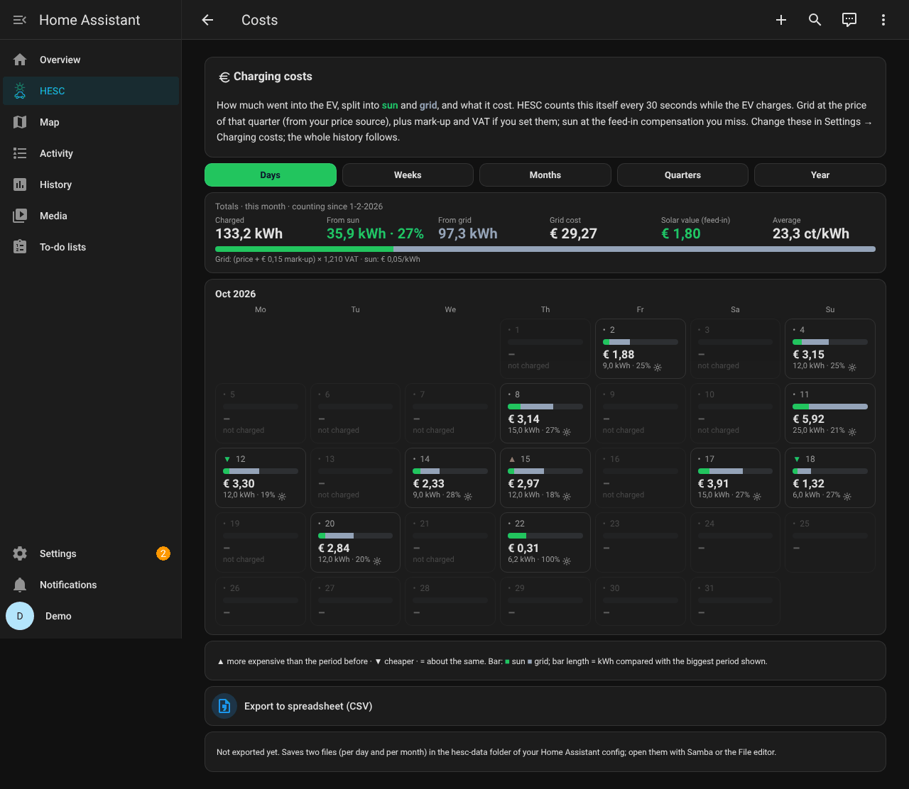
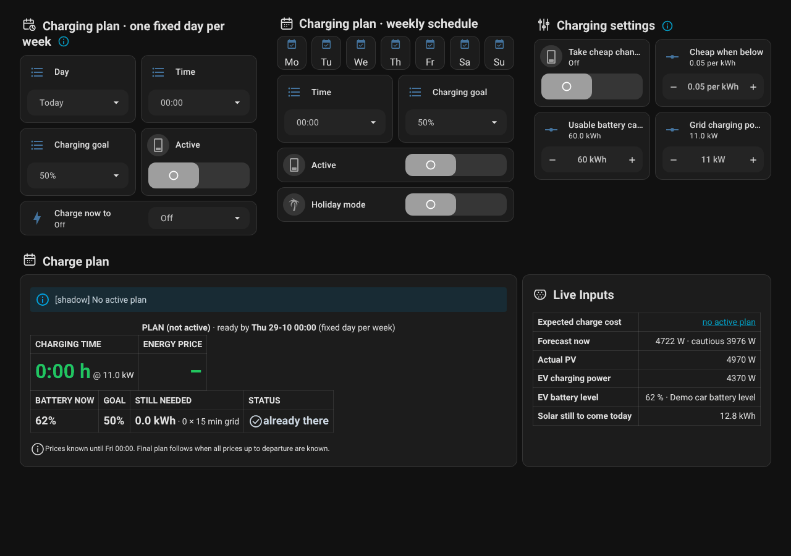
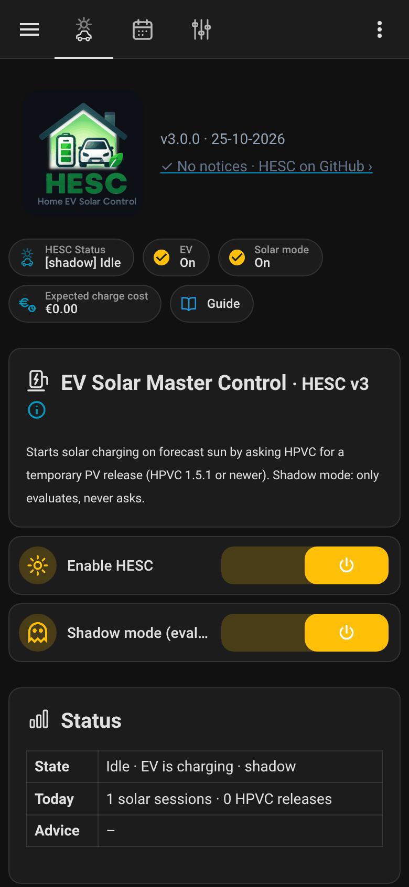

# 06 · Dashboard

*English: [06-dashboard.md](06-dashboard.md)*

**In het kort**
- Het dashboard heeft drie tabbladen: *Overzicht* (wat er nu gebeurt), *Laadplan* (wanneer de auto
  klaar moet zijn) en *Instellingen*. Daarnaast: de pagina *Kosten*, de uitleg (*Uitleg*, en in het
  Engels *Guide*) en een *Kiosk*-pagina voor een tablet aan de muur.
- Het meeste lees je alleen. Wijzigen doe je op *Laadplan* en *Instellingen*, en in het
  instelscherm.
- Het dashboard komt met HESC mee (zijbalk: **HESC**). De kaarten die het nodig heeft: [01 · Installatie](01-installation.nl.md#3-het-dashboard-toevoegen).

## Overzicht



### Bovenaan

- **Versie:** de versie van HESC die draait, naast het logo.
- **Meldingenregel:** *✓ Geen meldingen*, of de belangrijkste melding met de tijd. Rood = het
  laaddoel komt in gevaar (ook op je telefoon), oranje = er ontbreekt een sensor maar HESC werkt
  door, grijs = ter info. Tik erop om naar de plek te gaan waar je iets kunt doen.
- **Knopjes:**
  - *HESC-status*, *Auto* (aangesloten?), *Zonnestand* (staat de laadpaal op laden op zon?) en
    *HPVC begrenst*;
  - *Vrijgave*, alleen zolang HESC HPVC heeft gevraagd de zon door te laten;
  - *Verwachte laadkosten*: wat het actieve plan naar verwachting van het net kost;
  - *Kosten*: opent de kostenpagina (alleen als die op *Instellingen* aan staat);
  - *Uitleg*: opent de uitleg.

### EV Solar Master Control

- **HESC aan:** de hoofdschakelaar. Uit betekent dat HESC helemaal niets meer beoordeelt.
- **Schaduwmodus (alleen kijken):** HESC beoordeelt en toont alles, maar schakelt niets. Begin
  hier altijd mee.
- **HPVC heeft panelen vrijgegeven:** verschijnt zolang HPVC de zon doorlaat voor de auto.

### Status

- **Toestand:** wat HESC nu doet, en waarom.
- **Laatste actie:** het laatste wat HESC deed.
- **Vandaag:** het aantal sessies op zon en vrijgaves van HPVC vandaag.
- **Advies:** de startdrempel die HESC adviseert op basis van je eigen sessies die startten terwijl
  HPVC je panelen begrensde, naast de drempel van nu. Tik erop om naar *Instellingen* te gaan.
- **Rapport maken** eronder maakt een rapport met alles wat HESC heeft gemeten en besloten. Is
  het klaar, dan verandert de knop in **Rapport bekijken**.

### Live

De waarden van dit moment:

| Regel | Wat je ziet |
|---|---|
| **Net** | hoeveel je teruglevert aan het net of afneemt |
| **Thuisbatterijen** | hun vermogen (positief = laden) en hun gemiddelde stand; alleen als *Thuisbatterij en auto* is ingevuld |
| **Accustand auto** | de stand van de auto, *Auto telt als vol bij*, en waar de waarde vandaan komt |
| **Energieprijs nu** | de all-in-prijs en de marktprijs; alleen als energieprijzen zijn ingesteld |
| **Zon die vandaag nog komt** | hoeveel kWh de zon vandaag naar verwachting nog brengt |
| **Beste moment om aan te sluiten** | de eerstvolgende periode met genoeg zon om op zon te starten (het groen in de grafieken), bijvoorbeeld *zon morgen 11:00–17:30*; komt zulke zon niet, dan het goedkoopste uur van het net in de bekende prijzen |

### Huidige stand

Of de auto is aangesloten, de laadpaal op laden op zon staat, HPVC je panelen begrenst en er een
vrijgave loopt, met daaronder een tijdlijn van de laatste 12 uur. Staat *Thuisbatterij en auto* aan
en is de auto aangesloten, dan toont een extra regel wat de kickstart doet.

### Zonverwachting en realisatie · auto

De laatste 12 uur. Bovenaan: zonnestroom, verwachting en laadvermogen van de auto nu.

- paars: de verwachting;
- oranje: wat je panelen echt opwekten;
- blauw, onder de nullijn: wat er in de auto ging;
- de stippellijn: de startdrempel.

### Verwachting laadmogelijkheden op zon

De verwachte zon voor vandaag en morgen, per half uur. Bovenaan: de **Startdrempel** en de
**Doorlaaddrempel**. Groene balken = genoeg zon om te starten, oranje = genoeg om door te
laden maar niet om te starten, grijs = te weinig. *Nu* geeft het huidige moment aan.

### Verwacht laden op zon

Wanneer de auto vandaag en morgen naar verwachting op zon laadt, tussen zonsopgang en
zonsondergang, en hoeveel uur.

## Laadplan



- **Laadplan · één vaste dag per week:** een dag, een tijd en een laaddoel, bijvoorbeeld 100 %
  op vrijdag om 08:00. Komt elke week terug. *Actief* zet hem aan of uit.
- **Laadplan · weekplanning:** vink de dagen aan (*Ma* … *Zo*), kies een tijd en een laaddoel, bijvoorbeeld
  80 % op werkdagen om 07:00. Staan beide plannen aan, dan wint de vroegste.
- **Vakantiemodus:** het weekplan rust terwijl je weg bent; het plan voor één dag en laden op zon
  gaan gewoon door. *Vakantie tot (niet verplicht)*: de dag na die datum gaat hij vanzelf uit.
- **Eén dag overslaan (vrije dag):** kies een datum en het weekplan doet die dag niets; de volgende dag van
  het plan telt dan. Het plan zelf blijft staan. Zichtbaar als het weekplan aan staat.
- **Nu laden tot:** laadt meteen van het net tot de auto de gekozen stand heeft, daarna gaat de
  laadpaal terug naar zijn eigen zonnestand. Stopt vanzelf bij het doel, als de auto losgekoppeld
  wordt, of na de verwachte laadtijd × 1,5 plus een uur. Het werkt alleen als netladen is ingesteld
  (*Instellingen → Laadplan en meldingen*) en HESC de accustand van de auto kent; niet binnen 3 % van het doel,
  niet in schaduwmodus.
- **Laadinstellingen:**
  - *Goedkope kansen pakken* en *Goedkoop onder* — ook zonder plan laden als de prijs heel laag is;
  - *Bruikbare accucapaciteit* en *Laadvermogen van het net* — wat je auto echt kan opslaan en wat je
    laadpaal van het net levert.
- **Planstatus:** wat HESC doet voor welk plan en tot wanneer: laadtijd, gemiddelde
  energieprijs, verwachte kosten, accustand nu, doel, wat er nog nodig is en de status. Staan de
  goedkope kansen aan, dan staat je prijsgrens erbij in paars. Zonder actief plan zegt de kaart alleen
  *Geen laadplan actief*.
- **Prijsgrafiek:** de prijs voor vandaag en morgen als vloeiende lijn: lichtgrijs = de prijs,
  gestippeld met een bijna leeg vlak = een verwachte prijs (de echte prijzen van morgen zijn nog niet bekend). Gekleurde
  vlakken onder de lijn laten zien wanneer het loont om de auto aan te sluiten: groen = genoeg
  zon verwacht om op zon te starten (*Zon: starten*), amber = genoeg zon om door te laden, geen
  nieuwe start (*Zon: doorladen*), blauw = gepland netladen (*Netplan*), paars gestreept =
  een goedkope kans. Valt een goedkope kans in een zonnige periode, dan zie je het groen tussen
  de paarse strepen door.

## Instellingen



Drie kolommen: **1 · Je laadpaal**, **2 · Bronnen** en **3 · Geavanceerd**. De meeste velden komen
uit het instelscherm; de knop *Bronnen en laadpaal wijzigen* opent het.

**1 · Je laadpaal**
- *Type laadpaal* en *Opnieuw zoeken* — HESC zoekt de entiteiten van je laadpaal op.
- *Velden laadpaal* — wat HESC gebruikt; ze gaan vanzelf open als er iets ontbreekt.
- **Controle** — één regel per onderdeel met een vinkje. Een onderdeel dat niet klopt klapt open
  en zegt wat er ontbreekt.
- **Advies** — de startdrempel van nu en het advies. Daaronder de regel *Fasen* met het
  fase-advies, als je het netvermogen per fase hebt gekozen. *Advies automatisch toepassen* laat
  HESC de drempel in kleine stappen naar het advies schuiven. Zonder HPVC is er geen
  drempeladvies; de kaart toont dan alleen de drempel van nu en de schakelaar is verborgen.
- **Je instellingen** — je drempels, auto, tijden, laadplan en advies in één oogopslag.
- *Back-up maken*, *Back-up terugzetten*, *Standaardwaarden*.
- **Laadkosten** — *Aan* toont de kostenpagina; *Opties* toont de waarde van een
  zonne-kWh, *all-in*, of opslag en btw.

**2 · Bronnen**
- *HPVC gebruiken* — zet aan als je HPVC gebruikt (standaard uit).
- *Zonnestroom en net uit HPVC* — gebruik de zonne- en netsensoren van HPVC. Alleen als HPVC al je
  panelen ziet. Uit zet je eigen sensoren terug.
- *Bronnen wijzigen* — toont de sensoren voor zon, net en verwachting en de entiteiten van HPVC.
- *Extra velden tonen* — bijvoorbeeld *Auto telt als vol bij* en de waarden die "geen auto"
  betekenen.
- **Eigen weerstation** — *Aan* en *Opties* (zonlichtsensor en zijn drempels, en welke
  zonverwachting HESC gebruikt).

**3 · Geavanceerd — alleen als het nodig is**
- *Laaddrempels* — de drempels om te starten en door te laden, *Startdrempel per seizoen*, en
  *Auto telt als ladend boven*.
- *Tijden* — hoe lang HESC bij elke stap van een vrijgave wacht.
- *Advies* — over hoeveel dagen en vanaf hoeveel sessies.
- *Laadplan en meldingen* — start/stop-schakelaar, *Terug naar zonnestand*, de waarde voor "nu laden",
  prijsbron, prijssensor, *Prijzen per*, valuta, de eindcontrole, telefoons voor meldingen (met
  een testknop) en het ochtendoverzicht.
- **Minimumlading** — *Aan* en *Opties*: houd de auto minstens op een bepaalde stand, in de
  goedkoopste kwartieren.
- **Thuisbatterij en auto** — *Aan* en *Opties*: stand- en vermogenssensoren van de
  thuisbatterijen, hun grootte, *Kickstarts per dag* en *Minimale zon over voor de auto*.

Meer over elke instelling: [03 · Instellingen](03-settings.nl.md).

## Kosten



Open je met het knopje *Kosten* op *Overzicht*, als de kostenpagina op *Instellingen* aan staat.

- **Periode:** *Dagen*, *Weken*, *Maanden*, *Kwartalen* of *Jaar*.
- **Totalen:** hoeveel kWh er in de auto ging, van de zon en van het net, wat het netdeel kostte,
  en de waarde van de zonne-kWh.
- **Tegels:** één per dag (of week, maand …), met de kWh van zon (groen) en net (grijs) en de
  kosten.
- **Exporteren naar spreadsheet (CSV):** schrijft twee bestanden, per dag en per maand, die je in Excel
  opent.

## Guide en Uitleg

De uitleg in het dashboard, in het Engels (*Guide*) en het Nederlands (*Uitleg*). Dezelfde tekst
als [07 · Slim laden uitgelegd](07-smart-charging-explained.nl.md). De ⓘ naast een kop opent hem
ook.

## Kiosk



Een pagina voor een tablet aan de muur: beide plannen en de planinstellingen, wat HESC nu doet,
de planstatus en de waarden van dit moment. Open `/hesc-v3/kiosk` op de tablet. Het menu en de
bovenbalk van Home Assistant zijn op deze pagina verborgen; zet `?disable_km` achter het adres om
ze te houden. Er is geen extra kaart nodig (sinds 3.0.0). Na een herstart van Home Assistant
ververst de pagina zichzelf.

Zie ook: [05 · Laadpalen en bronnen](05-chargers-and-sources.nl.md) ·
[09 · Problemen oplossen](09-troubleshooting.nl.md)

## Op je telefoon en horloge



HESC werkt met de Home Assistant-app op een iPhone of een Android-telefoon, ook van buitenaf. Wat je
kunt is op allebei hetzelfde; alleen de knoppen op de telefoon verschillen.

**Wat HESC biedt (beide telefoons)**

- De sensor *Samenvatting voor telefoon en horloge*: één regel, bijvoorbeeld *EV 72% → 80% by Sat 24-10 07:00 ·
  Charging on sun · grid Fri 02:00*, of *EV 91% · not plugged in*. De losse waarden (accustand, doel,
  klaar om, volgend netkwartier, aangesloten, nu laden) staan in de eigenschappen, voor je eigen
  sjablonen.
- Acties:
  - **HESC: Laadplan instellen** (`hesc.set_charge_plan`: dag, tijd, doel — elk naar keuze; de tijd is
    een heel of half uur). Een plan zetten zet het ook aan.
  - **HESC: Laadplan uit** (`hesc.charge_plan_off`).
  - **HESC: Nu laden** (`hesc.charge_now`: doel) en **HESC: Nu laden stoppen**
    (`hesc.charge_now_off`).
  - **HESC: Een dag van het weekplan overslaan** (`hesc.skip_plan_day`: datum, naar keuze — zonder
    datum de eerstvolgende dag van het weekplan) en **HESC: Overslaan van een dag ongedaan maken**
    (`hesc.undo_skip_plan_day`).
- Kant-en-klare knoppen voor één tik: *Nu laden tot het laaddoel van het plan*, *Nu laden stoppen*,
  *Volgende dag van het weekplan overslaan*, *Overslaan van een dag ongedaan maken* en *Laadplan uit*.
- **Meldingen:** kies je telefoon op de pagina *Instellingen*.

Een widget, een snelknop of een horloge kan zo'n knop indrukken of een *script* starten. Voor iets
anders (een ander doel, een andere tijd) zet je de actie in een eigen script (*Instellingen →
Automatiseringen & scènes → Scripts*). Bijvoorbeeld, in YAML:

```yaml
hesc_laad_morgen_0700_95:
  alias: "HESC: laad morgen 07:00 tot 95 %"
  sequence:
    - action: hesc.set_charge_plan
      data: {day: Tomorrow, time: "07:00", goal: 95}
hesc_laad_nu_tot:
  alias: "HESC: laad nu tot"
  fields:
    doel:
      default: 80
      selector: {number: {min: 50, max: 100, step: 5, unit_of_measurement: "%"}}
  sequence:
    - action: hesc.charge_now
      data: {goal: "{{ doel | int(80) }}"}
hesc_dag_overslaan:
  alias: "HESC: sla de volgende dag van het weekplan over"
  sequence:
    - action: hesc.skip_plan_day
```

**iPhone en Apple Watch**

- **Widget of horloge:** zet *Samenvatting voor telefoon en horloge* als widget of als complicatie op je
  horloge in de Home Assistant-app.
- **Siri of Opdrachten:** maak een opdracht met de Home Assistant-handeling *Voer actie uit* (een van
  de HESC-acties hierboven) of *Voer script uit*. Zeg daarna bijvoorbeeld *Hé Siri, laad de auto
  voor morgen*.
- **Vergrendelscherm:** de widgets *Details* en *Gauge* verversen bij een stille melding. HESC stuurt
  die naar de iPhones en iPads in zijn telefoonlijst als er iets in de samenvatting verandert
  (aangesloten, plan, doel, laden, accustand per 10 %), hooguit eens per 20 minuten, zodat het
  dagbudget dat iOS hiervoor geeft nooit opraakt. Widgets op het beginscherm verversen ongeveer elke
  15 minuten; dat bepaalt iOS. Niet in schaduwmodus.

**Android-telefoon en Wear OS-horloge**

- **Widget:** de widget *Entiteitsstatus* met *Samenvatting voor telefoon en horloge*, of de widget *Sjabloon*
  voor je eigen tekst. Android-widgets verversen zelf: elke 30 minuten zolang het scherm aan is, of
  meteen als je de Home Assistant-app meldingen laat lezen met *Real-time* aan (Android-instellingen;
  kost iets meer accu). HESC stuurt Android-telefoons geen verversmelding; dat is een iOS-opdracht
  en zou als bericht verschijnen.
- **Eén tik:** de widget *Actieknop*, of een *snelknop* in het snelinstellingenmenu (in de app:
  *Instellingen → Companion-app → Tegels beheren*), die elk een HESC-knop indrukken of een van je
  HESC-scripts starten.
- **Spraak:** stel de Home Assistant-app in als assistent van de telefoon en vraag Assist een
  HESC-script uit te voeren.
- **Wear OS-horloge:** een tegel *Snelkoppelingen* met de HESC-knoppen of je HESC-scripts, en een complicatie
  *Entiteitsstatus* met *Samenvatting voor telefoon en horloge*.

Het Android-deel volgt de handleiding van de Home Assistant Companion-app; het is nog niet op een
Android-telefoon uitgeprobeerd.
